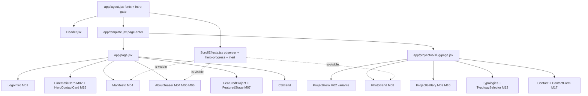

# WEBSITE_REDESIGN_PLAN — Raíces Developers

Plan maestro de rediseño del sitio institucional de Raíces Developers y de la página de Ceibo Vidal.
Fase: investigación, dirección de arte y planificación. **No se implementó código.** Este documento es la fuente de verdad para la fase de implementación (ejecutada por otro agente) y está escrito para que cada decisión pueda ejecutarse sin improvisar.

- Fecha: 28/10/2026 · **Revisión 2** (dirección creativa cerrada; ver "Registro de cambios" al final)
- Estado: dirección de arte, tipografía, gestos de motion, galería, selector de tipologías y scroll nativo **aprobados**. Decisiones P01–P14 resueltas en §18.
- Stack verificado: Next.js 16.2.9 (App Router, `output: 'export'`, `trailingSlash`, `images.unoptimized`), React 19.2.7, CSS puro (`app/globals.css` 2046 líneas + `app/cinematic.css` 1303 líneas), `next/font`, sin librerías de animación. Deploy estático desde `out/`. Formulario vía Cloudflare Worker (`functions/contact-worker.js`, Resend).
- Prioridad normativa: `DESIGN_SYSTEM.md` (marca V2) > `FRONTEND_DESIGN_SYSTEM.md` (propuesta web v1.0) > `docs/RAICES_DESIGN_SYSTEM.md` (estado implementado) > referencias externas.
- Nota: las dos grabaciones de pantalla adjuntas (`Screen Recording 2026-10-28 at 1.16.43 PM.mov` y `1.17.25 PM.mov`) no pudieron leerse: viven en una carpeta temporal protegida por macOS (`TemporaryItems/NSIRD_screencaptureui_*`) y el sistema devuelve "Operation not permitted / No such file". Para compensar se inspeccionaron las cinco referencias en vivo con Playwright (desktop y mobile) y se leyó su código de animación. Si las grabaciones contienen algo distinto a lo observado en los sitios, guardarlas en el repo o en el Escritorio y se incorporan antes de la Fase 2.

---

## 1. Executive Design Summary

**Qué se va a construir.** Un sitio editorial oscuro, de ritmo lento y preciso, que presente a Raíces como desarrolladora boutique y a Ceibo Vidal como su primer edificio, con un camino comercial visible desde la primera pantalla y sin recursos de landing genérica.

**Dirección de arte elegida: "Carbón editorial, capítulos de luz".**
Base Carbón `#101210` en todo el sitio; texto y líneas en Caliza `#D1C7BA`; un único acento Arena `#C4A97D` (trazo 28×2 px, kickers, índice de navegación); hojas Lino `#F0EDE6` solo para contenido técnico (plantas, mapa, ficha de tipología), que funcionan como "páginas de carpeta" apoyadas sobre el fondo oscuro. Tipografía oficial: **M PLUS U** (display, 300/400/500) + **Montserrat** (cuerpo, 400/500/600). Fraunces se retira.

**Lo que cambia respecto del sitio actual.**
1. Tipografía: Fraunces → M PLUS U (fuente local ya presente en `app/fonts/m-plus-u-latin.woff2`, variable 300–500, cargada con `next/font/local` como en el commit `fbbffc8`).
2. Motion: se reemplaza el sistema de "palabra por palabra" (`RevealText`) y "persianas de 6 bandas" (`.media-shutter`) por un vocabulario de **tres gestos**: línea enmascarada que sube, cortina de imagen (clip-path) y fundido cruzado. CSS + IntersectionObserver como base; la única dependencia de animación autorizada es **GSAP SplitText** (sin ScrollTrigger, sin ScrollSmoother) para dividir en líneas los títulos de texto largo. Sin Lenis, sin WebGL.
3. Home: intro de marca **monumental** con el logo completo oficial (≈1,75 s en total, el hero empieza a revelarse a los 1,35 s), hero simplificado (H1 institucional + un CTA editorial hacia Ceibo Vidal + **tarjeta de contacto** en desktop / botón de WhatsApp en mobile), manifiesto de una sola frase, filosofía en 3 principios, Ceibo Vidal como capítulo fijo (sticky, altura a validar por prototipo 180vh vs 220vh) con columna de imagen vertical, cierre de contacto y footer.
4. Ceibo Vidal: hero en dos paneles (texto / fachada vertical), síntesis, arquitectura con bandas fotográficas de parallax leve, galería tipo "escenario + tira", espacios comunes, **selector de tipologías** con hoja Lino y consulta por tipología prearmada en WhatsApp, ubicación, contacto con asunto preseleccionado.
5. Contacto: header con CTA, tarjeta en hero, WhatsApp flotante existente, consulta por tipología, formulario real. Sin popups.

**Qué no cambia.** Rutas, textos y datos (`app/content/`), logos oficiales, WhatsApp directo, envío real del formulario, export estático, Worker de Cloudflare.

**Métrica de éxito visual.** En 1440/768/390 el sitio se lee como una carpeta de venta impresa que respira: ningún elemento parpadea, ninguna animación supera 1,4 s salvo la intro (1,75 s), el LCP del hero es la imagen (no un video), `prefers-reduced-motion` muestra el sitio completo y estático, y en cada viewport hay **una sola acción comercial dominante** (WhatsApp).

---

## 2. Auditoría del estado actual

Fuentes: lectura completa de `app/` y `docs/`, capturas locales en `/tmp/raices-ref/current/` (servidor estático sobre `out/`).

### 2.1 Lo que funciona y se conserva
- Arquitectura de contenido centralizada en `app/content/*.ts` (`shared`, `home`, `ceibo-vidal`, `projects`, `about`, `contact`). Todo el plan referencia esas claves.
- `app/components/ScrollEffects.jsx`: observador único, `once`, `rootMargin -4%`, `threshold .08`; publica `--hero-progress`, `is-scrolled`, `past-hero`. Es la base del sistema de motion nuevo.
- `app/components/LogoIntro.jsx`: gate por `sessionStorage('raices-intro-seen')` resuelto en script inline en `app/layout.jsx` (`data-intro = seen | playing | done`), respeta reduced-motion, tecla para saltar. Se conserva la mecánica; cambia la coreografía y la duración.
- `app/components/ContactForm.jsx`: validación, honeypot, tiempo mínimo, estados `idle/sending/sent/error/unconfigured`, nunca simula envío. No se toca su lógica.
- `app/components/WhatsAppLink.jsx` acepta `message` y `source`: permite la consulta por tipología sin código nuevo de tracking.
- `app/components/ProjectGallery.jsx`: lightbox nativo `<dialog>`, teclado. Se conserva el lightbox.
- Tokens en `app/globals.css :root` ya alineados a la marca (Carbón, Caliza, Arena, `--radius-button 2px`, `--line-width .75px`, `--ease cubic-bezier(.22,1,.36,1)`).
- Header fijo 76 px, transparente en home y sólido al scroll; índice `01–03` en la navegación.

### 2.2 Problemas detectados (ordenados por impacto)
1. **Tipografía fuera de marca.** `app/layout.jsx` carga `Fraunces` como `--font-fraunces` y `app/globals.css` define `--font-display: var(--font-fraunces…)`. La marca V2 exige M PLUS U. El archivo local existe y no se usa. Además el hero usa `.hero-line-italic` (itálica de Fraunces): M PLUS U no tiene itálica, hay que redefinir el énfasis.
2. **Motion ruidoso.** Tres sistemas distintos conviven: `RevealText` (por palabra, `--i`), `.media-shutter` (6 bandas), `.mask-reveal`/`.img-reveal` (clip-path + scale), más `heroRise`, `lineRise`, `introReveal`, `cineDrift` (Ken Burns 32 s). El resultado es un sitio donde cada bloque entra de una forma distinta. Las referencias de nivel Awwwards usan uno o dos gestos repetidos con disciplina.
3. **Hero de Ceibo Vidal con imagen insuficiente.** `ceibo-vidal-fachada.webp` es 682×1024 (vertical). Hoy se estira a pantalla completa (`.hero-media`) y en 1440 px se ve blanda. Hay que componer alrededor del formato vertical, no contra él.
4. **Contacto tardío.** En home el primer acceso de contacto visible es el botón "Consultar" del header y el flotante de WhatsApp; el hero solo ofrece "Explorar proyectos / Conocer Raíces". En Ceibo Vidal el formulario está al final de ~8 pantallas.
5. **Tipologías como lista larga.** `app/components/sections/Typologies.jsx` apila tres `typology-card` completas (plano + render + datos). En 390 px son ~6 pantallas de scroll sin jerarquía ni comparación.
6. **Galería de tira con scroll-snap** (`.gallery-strip`): en desktop muestra tres recortes pequeños; no hay una imagen protagonista.
7. **Intro larga.** `HOLD_MS 1800 + LEAVE_MS 820` ≈ 2,6 s más el reveal del hero. Azimute dura 2,85 s pero arranca el hero a los 2,45 s; Loam libera el hero en cuanto sube la cortina. Objetivo: ≤ 1,9 s total hasta que el hero empieza a moverse.
8. **Capas duplicadas de CSS.** `globals.css` y `cinematic.css` definen variantes del mismo hero (`.hero` vs `.cine-hero`), dos escalas de títulos (`clamp(48px,7.2vw,108px)` en globals, `clamp(36px,4.8vw,72px)` en cinematic) y tres breakpoints distintos (1100 / 980 / 760 / 520). Hay que consolidar en una escala y una grilla.
9. **Navbar Lino vs Carbón** sin resolver (D01 de `FRONTEND_DESIGN_SYSTEM.md`). La marca V2 describe navbar Lino con wordmark Carbón; el sitio es oscuro. Decisión en §4.
10. **Datos pendientes de validación comercial** (`docs/CONTENT_REVIEW.md`): superficies A/B/C (carpeta 82/37/54 vs web 79,75/39,06/56,18), programa por unidad, 30/70, email, redes vacías, Worker sin endpoint configurado (`NEXT_PUBLIC_FORM_ENDPOINT`). No bloquean el rediseño, bloquean la salida a producción.

### 2.3 Inventario de assets utilizables (sin inventar renders)
- Fotografía/render limpios: `balcones-tensores.webp` 1536×1024, `terraza-verde.webp` (≤1536), `ceibo-vidal-fachada.webp` 682×1024, `presentacion-ceibo.webp`, `unidad-a-3amb.webp`, `unidad-b-mono.webp`, `unidad-c-2amb.webp`, `mapa-barrio-ceibo.webp` 1600×957.
- Piezas con texto incrustado (no usar como fotografía de fondo): `presentacion-ceibo-2.webp`, `presentacion-ceibo-3.webp`, `cada-detalle-importa.webp`, `arquitectura-con-identidad.webp` 819×1024.
- Planos: `ceibo-planta-tipo.webp` 2382×1474, `ceibo-tipologia-{3-ambientes,2-ambientes,monoambiente}.webp`.
- Marca: `raices_logo_completo.png` 789×856, `raices_logo_texto.png` 888×258, `raices_logo_icono.png` 749×893, `ceibo_logo_blanco.png` 622×257, `ceibo_logo_lino.png`, `ceibo_logo.png`, `og-image.png`. Socios: `daimar-developers-white.png`, `gyd-wordmark-white.png`.
- `public/assets/video/` está vacío: no hay video de hero. El plan no depende de video.

---

## 3. Análisis de las cinco referencias

Inspeccionadas con Playwright en ~1440 y ~390 px; capturas y código fuente guardados en `/tmp/raices-ref/{azimute,loam,puzoto,halcyon,gmx}/`. Los valores de animación citados se leyeron del código, no se estimaron.

### 3.1 Azimute (referencia principal) — `azimute.js`, `cinema.js`
- **Intro (entrance):** timeline GSAP de 2,85 s. Trazo del isotipo con `strokeDashoffset` 1,2 s `power2.inOut`; nombre con `clipPath inset(0 100% 0 0) → inset(0 0% 0 0)` 1 s `power3.out` a los 0,55 s; una "luz" horizontal (`xPercent -100 → 150`, 2,1 s, `sine.inOut`); salida: identidad `y:-18, opacity 0` 0,5 s a los 1,9 s y **cortina `clipPath inset(0 0 100% 0)` 1,25 s `power4.inOut` a los 2,05 s** (la pantalla se "levanta" hacia arriba). Header 0,7 s a los 2,35 s; contenido del hero `y:24→0` 1 s `power3.out` a los 2,45 s; indicador de scroll a los 2,85 s.
- **Hero scrubbeado:** `scrollTrigger start 'top top' end 'bottom bottom' scrub .65`; contenido `y:-50, opacity 0` entre 15 % y 39 % del hero; se marca `inert` cuando opacidad < 0,08 (detalle de accesibilidad a copiar).
- **Reveals de sección:** `gsap.from(el,{opacity:0,y:32,duration:1.25,ease:'power2.out', start:'top 94%', once:true})`; ignora elementos ya visibles al cargar.
- **Bandas fotográficas:** parallax sutil `scale 1.055`, `yPercent -2 → 2`, `scrub .7`, de `top bottom` a `bottom top`.
- **"Descenso fotográfico" (cinema.js):** sección sticky con 17 imágenes en WebGL, controles directos, `progress` nativo, fallback a ``. Fundido entre imágenes **0,72 s `sine.inOut`** y decodificación previa (`decode()`) antes de intercambiar capas.
- **Mobile:** mismas secciones apiladas, sin WebGL, tipografía grande; el menú ocupa toda la pantalla.
- **Qué se toma:** cortina de salida de intro hacia arriba; una sola curva de entrada para todos los reveals; parallax de ±2 %; fundido 0,72 s con decode previo; `inert` sobre contenido oculto.
- **Qué se descarta:** WebGL/Three.js, 17 imágenes, luz animada, scroll del hero scrubbeado (requiere GSAP).

### 3.2 Loam House (referencia principal) — `editorial.js` (80 KB), `script.js`
- **Arquitectura:** GSAP + ScrollTrigger + SplitText + **ScrollSmoother** (scroll virtual). Cada capítulo es un timeline scrubbeado (`scrub 2.5`, capítulo mapa `scrub 6`) donde el OUT es el espejo exacto del IN (easing invertido, stagger invertido). Esto es lo que da la sensación de "la página respira con el scroll".
- **Hero (una sola performance de carga, `timeScale 1.5`):** wordmark `opacity 0, blur 10px, y:-8` 3,6 s `power1.out`; **líneas del h1 (SplitText `type:'lines'`) entran desde lados alternos `x: ±28 % del viewport`, `opacity 0`, 2,6 s `expo.out`, más `filter blur(16px) → 0` 3,06 s `power1.out`**; eyebrow `y:46` 1,82 s a los 1,6 s; textos chicos `y:46, stagger .15`; botones del header `blur 8px` 1,7 s `stagger .12`. Con `timeScale 1.5` el hero completo dura ≈ 2,4 s reales.
- **Tarjeta de contacto en el hero ("ink card"):** solo ≥1051 px: `y:90, opacity 0, scale .97, blur 12px` 2,2 s `power3.out`; al terminar arma su salida scrubbeada `y:-120, blur 10px` entre 3 % y 33 % del hero. Formulario de 2 campos (nombre, email) + intención (brochure / llamada). Es el patrón de **"contacto desde la primera pantalla sin popup"** que adoptamos.
- **Reveals de capítulo:** títulos `x: ±dir, blur 22px` 4,4 s; cuerpos `y:46, blur 7px` 2,2 s `stagger .12`; listas `stagger .18`. **En mobile elimina el blur** (comentario del código: iOS Safari "pops" el `filter: blur`). Inputs: subrayado `scaleX 0→1` 0,55 s `power3.out` en focus, `scaleX 1→0` 0,4 s `power2.in` en blur.
- **Mobile:** deshabilita ScrollSmoother en táctil, mantiene slide+fade; tarjeta del hero pasa debajo del título.
- **Qué se toma:** tarjeta de contacto en hero (adaptada: WhatsApp + enlace al formulario, no un formulario completo), subrayado animado de inputs, títulos divididos en líneas, "sin blur en mobile", estado de reposo garantizado tras la entrada.
- **Qué se descarta:** ScrollSmoother/scroll virtual, blur como gesto principal (costo en GPU y "pop" en Safari), entradas laterales de ±28 % (demasiado teatral para Raíces), capítulos de 4 s.

### 3.3 Puzoto
- Portfolio claro, grilla 12 columnas con márgenes generosos, títulos enormes en una sola línea, listas de proyectos con hover que muestra imagen. Animaciones: reveal por líneas con `translateY(100 %)` dentro de `overflow:hidden`, ~0,8 s, stagger ~0,08 s; cursor custom.
- **Qué se toma:** la disciplina de líneas enmascaradas (sin blur, sin lateral) como gesto de texto; índice numerado `01/02/03` pequeño junto a títulos.
- **Qué se descarta:** cursor custom, fondo claro, hover de lista con imagen flotante (no tenemos portfolio).

### 3.4 Halcyon
- Sitio de real estate premium: hero full-bleed con video, overlay de degradé desde abajo, navbar transparente que se vuelve sólida, secciones alternando imagen/texto 50/50, galería con flechas y contador `01 / 08`, planos sobre fondo claro con selector de unidad en pestañas.
- **Qué se toma:** selector de tipologías por pestañas con plano grande y datos a un costado; contador `01 / 03` en galería; degradé del hero (ya existe como `.cine-hero-scrim`).
- **Qué se descarta:** video de hero (no hay asset), tipografía serif, sliders automáticos.

### 3.5 GMX Digital
- Agencia: intro con contador/preloader, transiciones de página con cortina, texto cinético, hover magnético en botones, mucho contraste de escala. Mobile reduce casi todo a fade.
- **Qué se toma:** solo la idea de transición de página con la misma cortina de la intro (versión corta, solo entrada) y hover de botón con relleno que sube.
- **Qué se descarta:** preloader con porcentaje, hover magnético, texto en marquee, ritmo de agencia.

### 3.6 Síntesis de vocabulario común (lo que comparten las cinco)
- Una curva de salida larga (`expo.out`/`power3.out`) para entradas; curva in-out solo para cortinas.
- Duraciones de 0,7–1,25 s para reveals; 0,25–0,4 s para hover.
- Textos que entran por líneas, nunca por palabra ni por letra.
- Imágenes que aparecen por máscara (clip-path/overflow) con un leve `scale 1.05 → 1`.
- Movimiento vertical de 24–50 px como máximo en entradas.
- Una sola animación "especial" por página (hero), el resto es repetición del mismo gesto.

---

## 4. Dirección de arte definitiva

### 4.1 Alternativas evaluadas
1. **Lino editorial (claro, estilo Loam/Puzoto).** Base `#F0EDE6`, texto Tinta, fotos a sangre. Pro: luminoso, coincide con la navbar Lino de la marca V2. Contra: todos los renders de Ceibo son nocturnos/oscuros y los logos de socios existen solo en blanco; el sistema web actual, el OG y la carpeta de venta ya son Carbón; cambiar de base invalida `docs/RAICES_DESIGN_SYSTEM.md` entero. Descartada.
2. **Cine total (Azimute).** Hero con video, secciones sticky con decenas de imágenes, scroll scrubbeado. Pro: impacto. Contra: no hay video ni serie fotográfica; requiere GSAP+WebGL; en un edificio de 12 unidades resulta desproporcionado y lento en mobile. Descartada.
3. **Carbón editorial, capítulos de luz (elegida).** Base Carbón; ritmo de capítulos con una imagen protagonista por sección; contenido técnico sobre hojas Lino con radio 8 px (como las páginas de planos de la carpeta); motion de tres gestos. Pro: usa lo que existe (tokens, assets, carpeta), diferencia claramente lo editorial (Carbón) de lo comercial/técnico (Lino), escala a futuros proyectos.

### 4.2 Reglas de la dirección elegida
- **Color.** Fondo `--bg #101210`; secciones alternas `--bg-alt #161714`; superficies `--surface #1c1d1a`. Texto principal Caliza `#D1C7BA`; texto secundario `--muted #a89e90`; líneas `rgba(209,199,186,.16)`. Acento Arena `#C4A97D` únicamente en: trazo de título (28×2 px), kickers, índice de navegación, estado activo de pestañas, subrayado de inputs en focus. Verde (Salvia/Liquen/Musgo) solo en el bloque "Aire libre" de Ceibo y en el diagrama de raíces. Ceibo `#B85C42` no se usa en UI (reservado al logo del proyecto). Hojas Lino `#F0EDE6` con texto Tinta `#21201E` para: plantas, planos de tipología, mapa, ficha de tipología.
- **Tipografía.** Display M PLUS U 300 para títulos grandes (≥56 px), 400 para títulos medianos y métricas, 500 solo para cifras destacadas. Cuerpo Montserrat 400; labels/kickers Montserrat 500 mayúscula tracking 0,08–0,10 em. Énfasis dentro de un título: cambio de peso (300 → 400) y de color (Caliza → Blanco `#F8F7F4`), nunca itálica.
- **Composición.** Grilla de 12 columnas, contenedor 1180 px (hasta 1320 en secciones full), gutter `clamp(20px,5vw,64px)`. Títulos alineados a la izquierda, apoyados sobre la línea base de la grilla; cotas y números pequeños en los extremos; mucho aire vertical (secciones `clamp(96px,12vw,160px)` arriba y abajo).
- **Imagen.** Una imagen protagonista por sección, en máscara rectangular sin radio en Carbón; radio 8 px solo en hojas Lino. Nada de duotono ni filtros: el escrim `linear-gradient(180deg, rgba(16,18,16,.08), rgba(16,18,16,.72))` solo en heroes con texto encima.
- **Líneas.** Divisores de 0,75 px Caliza al 16 %. Cotas (`Cota`) como firma: línea + número + texto pequeño.
- **Navbar: decisión D01.** Se mantiene **oscura** (Carbón translúcido al scroll) con wordmark Caliza mediante `logo-on-dark`. Justificación: la navbar Lino de la marca V2 está pensada sobre documentos y piezas claras; sobre un sitio Carbón crearía una franja clara permanente que compite con el hero. Se documenta en `docs/RAICES_DESIGN_SYSTEM.md` como excepción web. Pendiente de aprobación (§18, P01).

---

## 5. Diseño objetivo por página

Las secciones citan las claves de contenido existentes. No se crea texto nuevo salvo los literales de UI listados en §18 (P08), que deben agregarse en `app/content/shared.ts > ui` durante la implementación.

### 5.1 Home `/`

Orden definitivo: Intro de marca → Hero con tarjeta de contacto → Manifiesto → Filosofía → Proyecto destacado (capítulo fijo) → Cierre de contacto → Footer.

#### 5.1.0 Intro de marca (`LogoIntro.jsx`, reformulado) — "Logo monumental y cortina"
- Una vez por sesión (mecánica actual: script inline en `app/layout.jsx` + `sessionStorage('raices-intro-seen')`). Duración total **1,75 s**; el hero empieza a revelarse a los **1,35 s**, debajo de la cortina que sube.
- Protagonista: **logo completo oficial** `brand.logos.full` (`raices_logo_completo.png`, 789×856, proporción 0,92:1) con clase `logo-on-dark`, centrado óptica y geométricamente (centro del logo al 48 % de la altura del viewport, como la portada de la carpeta de venta). Sin isotipo separado, sin wordmark separado, **sin línea decorativa**: la composición del logo no se altera.
- Escala (altura del logo, el ancho sigue la proporción):
  - Desktop (≥1024): `clamp(260px, 38vh, 400px)` → a 1440×900 mide ~342 px de alto, ~315 px de ancho.
  - Tablet (760–1023): `clamp(220px, 32vh, 320px)`.
  - Mobile (≤759): `min(62vw, 36svh)` → a 390×844 mide ~242 px de alto, ~223 px de ancho. Márgenes laterales nunca menores a 48 px.
- "Saltar" (`ui.intro.skip`) abajo a la derecha, Montserrat 500 11 px mayúscula, Caliza al 60 %.
- Timeline completo en M01 (§7). El `LogoIntro.jsx` actual renderiza `.logo-intro-icon` + `.logo-intro-text` + `.logo-intro-line`: se reemplazan por un único `img.logo-intro-mark`.

```
1440                                                390
┌──────────────────────────────────────────┐        ┌──────────────────┐
│                                          │        │                  │
│                                          │        │                  │
│               ┌──────────┐               │        │     ┌──────┐     │
│               │          │               │        │     │      │     │
│               │   LOGO   │  ~342px alto  │        │     │ LOGO │     │
│               │ COMPLETO │               │        │     │      │     │
│               │          │               │        │     └──────┘     │
│               └──────────┘               │        │                  │
│                                          │        │                  │
│                                 SALTAR ↵ │        │         SALTAR ↵ │
└──────────────────────────────────────────┘        └──────────────────┘
```

#### 5.1.1 Hero (`CinematicHero.jsx`, reformulado) — 100svh
- Fondo: `homeContent.hero.media.image` (`balcones-tensores.webp`) a sangre, `object-position: 50% 40%`, escala de entrada 1,06 → 1. Escrim inferior. Sin Ken Burns continuo (se elimina `cineDrift`).
- Columna de texto: columnas 1–7 (desktop), alineada abajo (`align-self: end`), margen inferior `clamp(48px, 8vh, 96px)`.
  - Kicker `hero.kicker` (Montserrat 500 11–12 px, Arena).
  - H1 `hero.titleQuiet` + `hero.titleEmphasis` en dos o tres líneas; M PLUS U 300 `clamp(40px, 5.6vw, 88px)`, `line-height 1.02`, `letter-spacing -0.02em`; el énfasis en peso 400 y Blanco.
  - Lead `hero.lead` Montserrat 400 `clamp(16px,1.3vw,18px)`, máx. 52 ch, color `--text-soft`.
  - **Una sola acción editorial**: botón contorno con `homeContent.featured.link` ("Descubrir Ceibo Vidal" → `routes.project('ceibo-vidal')`). Se eliminan del hero `hero.primaryCta` ("Explorar proyectos") y `hero.secondaryCta` ("Conocer Raíces"): la navegación a `/proyectos` y `/nosotros` ya está en el header y en el footer. Las claves quedan en `home.ts` sin uso hasta que se decida borrarlas (no se modifican textos).
- **Tarjeta de contacto (nuevo `HeroContactCard.jsx`)**, solo ≥1024: columnas 9–12, alineada abajo, mismo margen. Fondo `rgba(16,18,16,.62)` con `backdrop-filter: blur(14px)` (fallback: `--surface`), borde 0,75 px, padding 24 px, sin radio, ancho máx. 360 px. Contenido: label `ui.footer.contactLabel` ("Contacto"), título corto `contactContent.defaults.title` en M PLUS U 400 22 px, **`WhatsAppLink source="hero-card"` como único botón relleno del viewport** (`ui.whatsapp.consultLabel`), enlace de texto al formulario (`routes.contact + '#formulario'`, literal `ui.contact.writeUs` "Escribinos →", ver P08) y debajo `contact.whatsappDisplay` en label. Sin campos de formulario (no duplicar `ContactForm`, no simular envío).
- Pie del hero (`.cine-hero-foot`): `Cota` con `hero.cota` a la izquierda, nota `hero.media.note` a la derecha, `scroll-cue` al centro apuntando a `#manifiesto`.
- Tablet (760–1023): sin tarjeta; acciones en una fila: `featured.link` (contorno) + WhatsApp (relleno, `source="hero-mobile"`).
- Mobile (≤759): texto en el tercio inferior; **exactamente dos botones**: `featured.link` (contorno) y WhatsApp (relleno, `source="hero-mobile"`), a ancho completo en ≤420. El acceso al formulario queda en el header (`ui.header.consultCta`) y en el cierre de página; la nota del pie se oculta y queda la cota.
- Jerarquía resultante por viewport: 1 relleno (WhatsApp) + 1 contorno (editorial) + header contorno pequeño. Nunca cuatro botones.

```
1440                                                               
┌─────────────────────────────────────────────────────────────────┐
│ [wordmark]         01 Proyectos 02 Nosotros 03 Contacto [Consultar]│ ← header transparente
│                                                                 │
│                                                                 │
│   RAÍCES DEVELOPERS                                             │
│   Hacemos edificios                                             │
│   donde nosotros mismos                       ┌───────────────┐ │
│   viviríamos.                                 │ CONTACTO      │ │
│   Creemos que un edificio debe estar …        │ Coordiná tu…  │ │
│   [Descubrir Ceibo Vidal →]                   │ [● WhatsApp]  │ │
│                                               │ Escribinos →  │ │
│                                               │ +54 9 11 …    │ │
│ ── 01 Raíces · Buenos Aires      ↓         Imagen de referencia │
└─────────────────────────────────────────────────────────────────┘
390
┌──────────────────┐
│ [wm]        ☰    │
│                  │
│ RAÍCES DEVELOPERS│
│ Hacemos edificios│
│ donde nosotros   │
│ mismos           │
│ viviríamos.      │
│ Creemos que…     │
│ [Descubrir Ceibo Vidal →]│
│ [● Consultar por WhatsApp]│
│ ── 01 Raíces     │
└──────────────────┘
```

#### 5.1.2 Manifiesto (nuevo `Manifesto.jsx`, `#manifiesto`)
- Sección de una sola frase: `homeContent.cta.title` ("Construimos espacios donde da placer vivir.") en M PLUS U 300 `clamp(36px, 5.2vw, 84px)`, columnas 2–11, alineada a la izquierda, con trazo Arena 28×2 px arriba. Redistribución aprobada (P07): el hero usa `hero.titleQuiet/titleEmphasis` ("Hacemos edificios donde nosotros mismos viviríamos."), el Manifiesto usa `homeContent.cta.title`, y el cierre de página repite `homeContent.cta.title` como remate de la página (el slogan «Espacios para echar raíces» fue descartado). No se crea texto: se reubica.
- Debajo, a la derecha (columnas 8–12), `homeContent.about.lead` en Montserrat 17 px.
- Fondo `--bg-alt`; padding vertical `clamp(120px,16vw,200px)`.

#### 5.1.3 Filosofía (`AboutTeaser.jsx`, reformulado, `#raices`)
- Grilla 5/7: izquierda columnas 1–5 texto; derecha columnas 6–12 imagen `homeContent.about.image` (`terraza-verde.webp`) con cortina de revelado, relación 4:5 en desktop, 3:2 en mobile.
- Texto: kicker `about.kicker`, título `about.titleQuiet` + `about.titleEmphasis` (M PLUS U 300/400 `clamp(32px,3.8vw,56px)`), `about.bridge` como cita corta, lista `about.principles` como tres filas con índice `01/02/03` en Arena, label en Montserrat 500, texto en `--text-soft`, separadas por líneas de 0,75 px; cierre con `text-link` a `/nosotros` (`about.link`).
- Mobile: imagen primero (3:2), luego texto.

#### 5.1.4 Proyecto destacado (`FeaturedProject.jsx`, reformulado como capítulo fijo)
- Sección de altura `var(--featured-height)` en desktop (**180vh o 220vh, a decidir por prototipo en la Fase 2**, ver tarea F2.4 y criterio en §15) con `position: sticky; top: var(--header-height)` en el bloque interior; la columna de imagen recorre tres paneles: 1) `project.cover` (fachada 682×1024, vertical, encaja sin recorte), 2) `terrace` (terraza-verde), 3) `balconies` (balcones). Cada panel ocupa 100 % de la columna y se intercambia por fundido cruzado al cruzar el 50 % del viewport (M07). No hay scrub: solo tres estados.
- **Protocolo del prototipo (F2.4):** implementar `FeaturedStage` con `--featured-height` como variable; generar dos builds locales (180vh y 220vh) y, con Playwright a 1440×900 y 1280×720, grabar capturas a 0/25/50/75/100 % del scroll de la sección y medir: (a) píxeles de scroll por panel (objetivo 500–700 px por estado en 1440×900; por debajo de 450 px los fundidos se pisan, por encima de 800 px la sección se siente detenida), (b) que el tercer panel llegue a verse completo antes de que la sección se despegue, (c) que el indicador `01/03 → 03/03` cambie en tres momentos claramente separados. Se elige la altura que cumpla (a)–(c) en ambos viewports; si ambas cumplen, se elige **180vh** (menos scroll). El valor elegido se fija en CSS y se registra en `docs/RAICES_DESIGN_SYSTEM.md`. Además, `@media (max-height: 640px)` desactiva el sticky.
- Columna texto (columnas 1–5): kicker `homeContent.featured.kicker` ("Proyecto 001 · Saavedra"), `ProjectMark` (logo `project.logo` a 190 px, «Vidal 3849» en Montserrat chica y la línea comercial `project.commercialLine`; sin título `project.name` ni `locationLong` bajo el logo), `dl` con `program/unitsLabel/deliveryYear` (tres filas con línea), botón flecha contorno `featured.link` ("Descubrir Ceibo Vidal") y, debajo, `WhatsAppLink source="featured"` como `text-link` (no botón) con `ui.whatsapp.consultLabel`. Ningún botón relleno en esta sección.
- Columna imagen (columnas 6–12): relación 3:4, borde superior alineado al header; en la esquina inferior derecha, índice `01 / 03` + caption de la imagen activa (`gallery.items[i].caption`) y nota (`note`).
- Mobile: sin sticky; la imagen de fachada 4:5 arriba, texto debajo, y las otras dos imágenes se omiten (quedan en la galería de Ceibo).

```
┌──────────────────────────────────────────────────────────────┐
│ PROYECTO 001 · SAAVEDRA        ┌───────────────────────────┐ │
│ [ceibo logo]                   │                           │ │
│ Ceibo Vidal                    │                           │ │
│ Vidal 3849, Saavedra, CABA     │      fachada (3:4)        │ │
│ Un equilibrio entre ciudad…    │                           │ │
│ ──────────────────────────     │                           │ │
│ Programa    PB + 4 · 12 unid.  │                           │ │
│ Entrega     2029               │                           │ │
│ ──────────────────────────     │              01/03 Fachada│ │
│ [Descubrir Ceibo Vidal →]      └───────────────────────────┘ │
│ ● Consultar por WhatsApp                                     │
└──────────────────────────────────────────────────────────────┘
```

#### 5.1.5 Cierre de contacto (`CtaBand.jsx`, con dos acciones)
- Título `homeContent.cta.title` («Construimos espacios donde da placer vivir.», P07 y corrección de branding) en M PLUS U 300 `clamp(40px,6.8vw,108px)`, texto `homeContent.cta.text`, acciones: `WhatsAppLink source="cta-band"` relleno + botón contorno a `/contacto` (`homeContent.cta.link`). Fondo `--bg-alt` con línea superior.
- Se agrega prop `secondary` a `CtaBand` para el segundo botón (ver §8).

#### 5.1.6 Footer (`Footer.jsx`, ajuste visual)
- Mantiene estructura (logo completo, navegación, contacto, bottom). Cambios: logo completo a 120 px de alto, columnas 4/4/4, `site-footer-bottom` en 11 px Montserrat 500 mayúscula; "Volver arriba" con flecha ↑.

### 5.2 Ceibo Vidal `/proyectos/ceibo-vidal`

Orden definitivo (igual al actual, con cambios internos): Hero → Síntesis (`IntroBand`) → Arquitectura (`Project` + bandas fotográficas) → Galería (`ProjectGallery` escenario + tira) → Aire libre / espacios comunes (`Green`) → Tipologías (`Typologies` + `TypologySelector`) → Ubicación (`Location`) → Socios (`Partners`) → Contacto (`Contact`).

Distinción editorial / comercial:
- **Editorial (Carbón):** hero, síntesis, arquitectura, galería, aire libre, ubicación-texto, socios.
- **Comercial/técnico (hojas Lino):** planta tipo, selector de tipologías (plano, superficies, render, botón de consulta), mapa, formulario (se mantiene oscuro pero con subrayados Arena).

#### 5.2.1 Hero (`sections/ProjectHero.jsx`, reformulado a dos paneles) — 100svh
- Desktop: panel izquierdo columnas 1–6 en Carbón; panel derecho columnas 7–12 con `project.cover` (fachada vertical) a sangre hasta el borde derecho, `object-fit: cover`, `object-position: 50% 30%`, cortina de revelado desde abajo. Sin estirar la imagen a toda la pantalla: a 1440 px la columna mide ~720 px de ancho, la imagen de 682 px se escala ~1,05: aceptable. Con renders nuevos (P05) el panel puede pasar a 7–12 a sangre total.
- Panel texto: `ProjectMark` (logo 180 px + «Vidal 3849», sin kicker con el nombre), H1 `project.headline` ("Un equilibrio entre ciudad y aire libre.") M PLUS U 300 `clamp(36px,4.6vw,72px)` con trazo Arena debajo, lead `hero.lead`, acciones (misma regla que la home: un relleno comercial + un contorno editorial): `WhatsAppLink source="project-hero"` **relleno** y botón contorno → `#tipologias` (`hero.primaryCta`). Pie: `Cota` con dirección (`project.address`, `neighborhood`) y nota de render (`ui.footer.disclaimer` ya existe como literal de renders).
- Mobile: la fachada ocupa el 62svh superior (4:5 recortado), el texto va debajo sobre Carbón; el H1 baja a `clamp(32px,9vw,40px)`.

```
┌───────────────────────────────┬────────────────────────────┐
│ [ceibo logo]                  │                            │
│ CEIBO VIDAL · SAAVEDRA        │                            │
│                               │                            │
│ Un equilibrio                 │        fachada             │
│ entre ciudad                  │        (vertical,          │
│ y aire libre.                 │         a sangre)          │
│ ──                            │                            │
│ Lead…                         │                            │
│ [● WhatsApp] [Ver tipologías] │                            │
│ ── Vidal 3849 · Saavedra      │   Renders de referencia    │
└───────────────────────────────┴────────────────────────────┘
```

#### 5.2.2 Síntesis (`IntroBand.jsx`) — sin cambios estructurales
- Tres ítems en columnas 1–4 / 5–8 / 9–12, líneas de 0,75 px entre ellos, números en M PLUS U 400 32 px si el texto es numérico (p. ej. "12 unidades"), de lo contrario Montserrat. Reveal escalonado.

#### 5.2.3 Arquitectura (`sections/Project.jsx` + nuevo `PhotoBand.jsx`)
- `split-grid.project-intro` (5/7) con `architecture.characteristics` en lista con índice; `spec-grid` de 3–4 tarjetas con número en M PLUS U 400 `clamp(28px,3vw,44px)`.
- Entre el intro y las specs, una **banda fotográfica** (`PhotoBand`) a sangre de 70vh con `presentacion-ceibo.webp` y parallax de ±2 % (M08). Entre specs y amenities, una segunda banda con `balcones-tensores.webp` solo si no se repite en la galería del mismo viewport; si no, se omite (una banda alcanza).
- Amenities y extras en dos columnas con línea separadora.

#### 5.2.4 Galería (`ProjectGallery.jsx`, reformulado: escenario + tira)
- Desktop: escenario columnas 1–9 relación 16:10 con fundido cruzado entre `gallery.items` (M09); columnas 10–12: caption de la activa, nota, contador `01 / 03`, controles prev/next (`ui.gallery`), y tira vertical de miniaturas (3) con la activa marcada por línea Arena. Click en el escenario abre el lightbox existente.
- Mobile: escenario 4:3 a sangre, controles debajo, miniaturas como fila horizontal; sin scroll-snap.
- Se conserva `<dialog class="lightbox">`, teclado, foco.

```
┌───────────────────────────────────────────┬──────────────┐
│                                           │ 01 / 03      │
│                                           │ Fachada sobre│
│            imagen activa (16:10)          │ Vidal        │
│                                           │ Render de ref│
│                                           │ [←] [→]      │
│                                           │ ▣ ▢ ▢        │
└───────────────────────────────────────────┴──────────────┘
```

#### 5.2.5 Aire libre / espacios comunes (`sections/Green.jsx`)
- Se mantiene `feature-grid` (tarjeta ancha + dos angostas). Cambios: imágenes con cortina de revelado; tarjeta `system-card` con el diagrama de raíces animado por trazo (M10). Paleta verde solo aquí: label en Salvia, diagrama en Liquen sobre `--surface`.

#### 5.2.6 Tipologías (`sections/Typologies.jsx` + nuevo `TypologySelector.jsx`)
- Cabecera: kicker/título/lead de `typologies`.
- **Planta tipo** (`floorPlan`) sobre hoja Lino, radio 8 px, columnas 2–11, con cota `floorPlanCota` debajo.
- **Selector**: barra de pestañas con `units[i].code` + `units[i].name` (A · 3 ambientes, B · Monoambiente, C · 2 ambientes); pestaña activa con subrayado Arena 2 px que se desplaza (M12). Panel activo en hoja Lino: plano `unit.plan` (columnas 1–7), ficha (columnas 8–12) con `dl` de superficies (cubierta / balcón / total, en M PLUS U 400 28 px con unidades en Montserrat 12 px), descripción, render `unit.render` 3:2 debajo de la ficha, y **dos acciones**: `WhatsAppLink source="typology-{code}" message={…}` como botón relleno oscuro ("Consultar por esta tipología", literal nuevo P08) y enlace al formulario con `defaultSubject="Ceibo Vidal"` (ya existe en `contact.subjects`). El mensaje prearmado debe construirse en contenido (`ceiboVidal.typologies.units[i].inquiry`, P08), no en el componente.
- Deep links: se mantienen los ids `#tipologia-{id}`; al cargar con hash se activa esa pestaña. Renderizado: las tres fichas se renderizan en el HTML (SEO + sin JS) y el selector solo alterna visibilidad (`hidden` + `aria-selected`).
- Mobile: pestañas como fila desplazable (scroll horizontal con `scroll-snap-type: x proximity`), panel apilado: plano → ficha → render → acciones.

```
┌──────────────────────────────────────────────────────────────┐
│ TIPOLOGÍAS                                                    │
│ Tres tipologías.                                              │
│ ┌──── Lino ────────────────────────────────────────────────┐  │
│ │                   planta tipo                            │  │
│ └──────────────────────────────────────────────────────────┘  │
│  A · 3 ambientes    B · Monoambiente    C · 2 ambientes       │
│  ━━━━━━━━━━━━━━━                                              │
│ ┌──── Lino ────────────────────────┬──────────────────────┐   │
│ │                                  │ Cubierta    68,67 m² │   │
│ │        plano unidad A            │ Balcón      11,08 m² │   │
│ │                                  │ Total       79,75 m² │   │
│ │                                  │ Descripción…         │   │
│ │                                  │ [render 3:2]         │   │
│ │                                  │ [● Consultar por A]  │   │
│ │                                  │ Escribinos →         │   │
│ └──────────────────────────────────┴──────────────────────┘   │
└──────────────────────────────────────────────────────────────┘
```

#### 5.2.7 Ubicación (`sections/Location.jsx`)
- Grilla 5/7: texto con `location.points` como lista con línea; mapa `location.map` en hoja Lino radio 8 px con cortina de revelado y cota.

#### 5.2.8 Socios (`sections/Partners.jsx`)
- Fila de logos blancos (`partners`) a 28 px de alto, opacidad .72, hover 1; label a la izquierda. Sin cambios de datos.

#### 5.2.9 Contacto (`sections/Contact.jsx`)
- Se mantiene 5/7 (canales / formulario). Cambios visuales: inputs con solo línea inferior (0,75 px) y subrayado Arena animado en focus (M17); `defaultSubject="Ceibo Vidal"` en la página de proyecto (ya lo hace `whatsappSource="project-contact"`; agregar `defaultSubject`).

### 5.3 Proyectos `/proyectos`
- `PageHeader` con título por líneas; lista `projects-grid` con tarjeta 7/5 (imagen 4:5 con cortina, texto) y `projects-note`. Ceibo Vidal es la única entrada; la grilla ya escala.

### 5.4 Nosotros `/nosotros`
- `PageHeader` → `Philosophy` (cita grande por líneas) → `Identity` (dos bloques 5/7 alternados con `aboutContent.practice` y `aboutContent.promise`) → `Statement` → `Partners` → `CtaBand`. Solo cambia tipografía, espaciado y motion; sin nuevas secciones.

### 5.5 Contacto `/contacto`
- `PageHeader` + `Contact id="formulario"`. En desktop, a la derecha del header, la cota con `contact.whatsappDisplay` y `contact.email` para que el dato esté en la primera pantalla.

### 5.6 Header y navegación (`Header.jsx`)
- Altura 76 px → 72 px al scroll (`is-scrolled`), fondo `rgba(16,18,16,.78)` + `backdrop-filter: blur(12px)` + línea inferior 0,75 px. En home arranca transparente. Wordmark 26 px de alto (`logo-on-dark`). Navegación con índice `01–03` en Arena, subrayado 1 px al hover/activo. CTA `ui.header.consultCta` como botón contorno pequeño → `/contacto`.
- Menú mobile: overlay Carbón a pantalla completa con los tres ítems en M PLUS U 300 40 px, índice, CTA WhatsApp abajo y `contact.whatsappDisplay`. Cierre con la misma cortina (M14).

---

## 6. Layout y responsive

### 6.1 Grilla y contenedores
- 12 columnas, `gap: clamp(16px, 2vw, 32px)`. Contenedor `--container: 1180px`; variante `--container-wide: 1320px` para hero, capítulo destacado y galería. Gutter `--gutter: clamp(20px, 5vw, 64px)`.
- Clase utilitaria única `.grid-12 { display:grid; grid-template-columns: repeat(12, minmax(0,1fr)); gap: var(--grid-gap); }` y `.col-{start}-{span}` solo para los rangos usados (1-5, 1-6, 1-7, 2-10, 6-7, 7-6, 8-5, 9-4). No instalar un sistema de grilla.

### 6.2 Breakpoints (consolidados)
- `≥1280` desktop amplio (diseño de referencia 1440).
- `1024–1279` desktop compacto: mismas columnas, tipografía por `clamp`.
- `760–1023` tablet: grillas 5/7 pasan a 12/12 apiladas salvo `Contact` (que mantiene 5/7 hasta 900).
- `≤759` mobile: una columna; `--gutter 20px`; sticky desactivado; tarjeta de hero → botones.
- `≤420` mobile chico: H1 `clamp` mínimo, botones a ancho completo.
- Se eliminan los breakpoints 1100 y 520 actuales y se migran sus reglas a 1024 y 420.

### 6.3 Espaciado vertical
- `--space-section: clamp(96px, 12vw, 160px)`; `--space-block: clamp(48px, 6vw, 88px)`; `--space-stack: clamp(20px, 2.4vw, 32px)`. Hero: 100svh. Capítulo destacado: `--featured-height` (180vh o 220vh según prototipo F2.4) en desktop / auto en mobile.

### 6.4 Escala tipográfica (única, reemplaza las dos actuales)
- `--fs-hero: clamp(40px, 5.6vw, 88px)` M PLUS U 300, lh 1.02, ls -0.02em.
- `--fs-display: clamp(36px, 5.2vw, 84px)` M PLUS U 300, lh 1.04 (manifiesto, cierre).
- `--fs-h1: clamp(36px, 4.6vw, 72px)` 300 (page headers, hero Ceibo).
- `--fs-h2: clamp(32px, 3.8vw, 56px)` 300/400 (secciones).
- `--fs-h3: clamp(22px, 2vw, 28px)` 400.
- `--fs-metric: clamp(28px, 3vw, 44px)` 400/500 (superficies, specs).
- `--fs-lead: clamp(16px, 1.3vw, 18px)` Montserrat 400, lh 1.6.
- `--fs-body: 15.5px` lh 1.62; `--fs-small: 13px`; `--fs-label: 11px` 500 mayúscula ls .08em; `--fs-kicker: 12px` 500 mayúscula ls .1em.
- Mobile: los `clamp` ya bajan; además `--fs-hero` mínimo 36 px en ≤420.

### 6.5 Alturas y proporciones de imagen
- Hero home: 100svh, imagen cover. Hero Ceibo: 100svh en desktop (panel 6/6), 62svh imagen + texto en mobile.
- Capítulo destacado: imagen 3:4 (desktop), 4:5 (mobile).
- Filosofía: 4:5 desktop, 3:2 mobile. Galería: 16:10 desktop, 4:3 mobile. Bandas fotográficas: 70vh desktop, 56vh mobile. Render de tipología: 3:2. Planos: proporción natural dentro de la hoja Lino con padding 24–40 px.

---

## 7. Motion Design Specification

Principios: scroll nativo (sin smooth-scroll ni hijacking); solo `transform`, `opacity` y `clip-path` (nunca `filter: blur` en mobile, y en desktop solo en la tarjeta del hero); un reveal ocurre una sola vez; nada se anima al salir del viewport salvo el capítulo fijo; con `prefers-reduced-motion: reduce` todo se muestra en estado final sin transición (excepto hover/focus, que pasan a 0 ms).

Tokens de motion (agregar a `app/globals.css :root`):
```
--ease-out: cubic-bezier(.22, 1, .36, 1);        /* existente --ease */
--ease-out-expo: cubic-bezier(.16, 1, .3, 1);     /* entradas largas */
--ease-in-out: cubic-bezier(.76, 0, .24, 1);      /* cortinas */
--ease-std: cubic-bezier(.4, 0, .2, 1);           /* hover/UI */
--dur-ui: 240ms; --dur-reveal: 800ms; --dur-image: 950ms;
--dur-curtain: 900ms; --dur-page: 600ms; --stagger: 90ms;
--rise: 28px;
```

Cada animación: nombre · elemento · estado inicial → final · trigger · duración/delay/stagger · easing · salida del viewport · mobile · reduced-motion · tecnología · riesgos.

### M01 Intro de marca ("Logo monumental y cortina")
- Elemento: `.logo-intro` (`LogoIntro.jsx`, `position: fixed; inset: 0; z-index` sobre todo), un único `img.logo-intro-mark` (logo completo, `logo-on-dark`), botón `.logo-intro-skip`.
- Timeline (t = 0 al montar con `data-intro="playing"`; duración total **1750 ms**):
  - **0–200 ms:** fondo Carbón pleno, logo invisible (`opacity 0`). El header y el flotante de WhatsApp permanecen ocultos (`html[data-intro='playing'] .site-header, .whatsapp-float { opacity:0 }`, ya existe).
  - **200–850 ms — revelado del logo:** `img.logo-intro-mark` de `opacity 0, transform: scale(.94) translateY(12px), clip-path: inset(0 0 100% 0)` a `opacity 1, scale(1) translateY(0), clip-path: inset(0 0 0 0)`; 650 ms, `--ease-out-expo`, delay 200 ms. El logo se revela de arriba hacia abajo mientras asienta (la máscara recorre el isotipo y luego el texto del logo completo en el orden natural de lectura).
  - **850–1150 ms — logo estable:** sin movimiento (300 ms de reposo).
  - **1150–1750 ms — cortina:** `.logo-intro` `clip-path: inset(0 0 0 0)` → `inset(0 0 100% 0)` en 600 ms `--ease-in-out` (se levanta hacia arriba). El logo no se anima por separado: sube con la cortina (percepción de una sola superficie que se retira).
  - **1350 ms:** se setea `document.documentElement.dataset.intro = 'done'` (cortina al 33 %) y arranca M02: el hero se revela debajo mientras la cortina termina de subir.
  - **1750 ms:** `.logo-intro` recibe `display:none` (o se desmonta); se guarda `sessionStorage('raices-intro-seen')`.
- Constantes en `LogoIntro.jsx`: `REVEAL_DELAY_MS = 200`, `REVEAL_MS = 650`, `HOLD_MS = 300`, `CURTAIN_MS = 600`, `HERO_RELEASE_MS = 1350`, `TOTAL_MS = 1750`. Toda la coreografía va en CSS keyframes con `animation-delay`; JS solo programa `HERO_RELEASE_MS` y `TOTAL_MS` con `setTimeout` y maneja Saltar.
- Saltar (click en `.logo-intro-skip`, Escape, Enter, Space): si `t < 1150`, salta directamente a la cortina (clase `.is-leaving` que fuerza la animación de cortina desde el estado actual, 600 ms) y setea `done` a los 200 ms de iniciada; si `t ≥ 1150`, no hace nada (ya está saliendo).
- Mobile: idéntica secuencia; tamaños de §5.1.0. Reduced-motion: no se renderiza (`data-intro='seen'` desde el script inline, ya resuelto) y el hero aparece en estado final.
- Accesibilidad: `.logo-intro` se mantiene decorativo (`aria-hidden="true"` en la imagen; sin `role="dialog"`), el botón Saltar es enfocable y tiene texto visible; Escape/Enter/Space funcionan vía listener global como hoy; no se mueve el foco al terminar.
- Tecnología: CSS keyframes + `animation-delay`; `dataset` + dos `setTimeout`. Sin librerías.
- Riesgos: `clip-path` animado sobre un `fixed` de pantalla completa es barato (compositor). El PNG del logo (789×856) debe estar precargado: `<link rel="preload" as="image" href={brand.logos.full.src}>` en `app/layout.jsx` solo cuando `data-intro` será `playing` no es posible en SSR estático → se agrega el preload siempre (el footer también usa el mismo archivo, no hay desperdicio). Flash del hero antes de la intro: ya cubierto por `html[data-intro='playing'] .cine-hero-media { opacity:0 }`, mantener.

### M02 Hero reveal (home)
- Elementos: `.cine-hero-media`, `.cine-hero .kicker`, líneas del H1 (`RevealLines` modo `static`), `.hero-lead`, `.hero-actions`, `.hero-contact-card`, `.cine-hero-foot`, header.
- Inicio (t = 0 = `data-intro` pasa a `done` a los 1350 ms de la intro, o `seen` al cargar sin intro). Con intro, los primeros 400 ms de esta secuencia ocurren mientras la cortina todavía sube (la imagen se descubre de arriba hacia abajo "ya en movimiento", como Azimute a los 2,45 s):
  - Imagen: `opacity 1` (no se anima la opacidad con intro para que la cortina descubra una imagen ya presente; con `seen`, `opacity 0 → 1` 600 ms), `scale 1.06 → 1`; 1400 ms `--ease-out-expo`; delay 0.
  - Kicker: `opacity 0, translateY(12px)` → `1, 0`; 600 ms; delay 450 ms.
  - Líneas del H1: cada línea `translateY(105%)` dentro de `overflow:hidden` → `0`; 820 ms `--ease-out-expo`; delay 520 ms; stagger 90 ms.
  - Lead y acción editorial: `opacity 0, translateY(var(--rise))` → final; 700 ms `--ease-out`; delay 900 ms y 1000 ms.
  - Tarjeta de contacto (≥1024): `opacity 0, translateY(40px), scale .98` → final; 900 ms `--ease-out-expo`; delay 1050 ms (en desktop se permite `filter: blur(8px) → 0` en paralelo, 900 ms; en tablet/mobile no hay tarjeta y el botón de WhatsApp entra con las acciones).
  - Pie y scroll-cue: `opacity 0 → 1`; 600 ms; delay 1350 ms. Header: `opacity 0 → 1` 600 ms, delay 1100 ms (solo en home con intro; con `seen` el header entra a 200 ms).
  - Fin de la secuencia: ≈ 2,0 s después de `done` (≈ 3,35 s desde la carga con intro; ≈ 2,0 s sin intro).
- Salida del viewport: al scrollear, `--hero-progress` (ya existe) controla `opacity` del contenido `1 → 0` entre 0,15 y 0,45 y `translateY 0 → -40px`, con `transition: none` (valor calculado). Se añade `inert` al contenido cuando `--hero-progress > .6` (como Azimute) desde `ScrollEffects.jsx`.
- Mobile: mismas duraciones, `--rise 20px`, sin escala de imagen (`scale 1.03`).
- Reduced-motion: todo visible en estado final; `--hero-progress` sigue aplicando opacidad (no es movimiento) pero sin translate.
- Tecnología: CSS keyframes activadas por `html[data-intro='done'], html[data-intro='seen']`; `RevealLines` modo `static` (líneas explícitas `hero.titleQuiet` / `hero.titleEmphasis`, sin medición del DOM) para el H1.
- Riesgos: ninguno de CLS en el H1 (las líneas están en el HTML desde el SSR). Si `titleEmphasis` ocupa dos líneas visuales en ≤420 px, ambas suben juntas dentro de la misma máscara (aceptable y previsto).

### M03 Header
- Estado inicial transparente (home) → `is-scrolled` al superar 18 px: fondo `rgba(16,18,16,0) → .78`, línea inferior `opacity 0 → 1`, altura 76 → 72 px; `transition: background-color 360ms, height 360ms, border-color 360ms --ease-std`.
- Al abrir el menú mobile: ver M14. Reduced-motion: transición 0 ms. Tecnología: CSS + estado `scrolled` existente.

### M04 Revelado de texto por líneas (gesto base)
- Elementos: todo `h1`, `h2`, título de manifiesto, citas (`Philosophy`, `Statement`, `.quote`), títulos de `PageHeader` y `CtaBand`. Reemplaza a `RevealText`.
- Estado inicial: cada línea envuelta en `.rl-line { display:block; overflow:hidden }` > `.rl-inner { display:block; transform: translateY(105%) }`. Final: `translateY(0)`.
- Trigger: `IntersectionObserver` (clase `.is-visible`), `rootMargin 0 0 -10% 0`, `threshold .2`; once. En el hero, `immediate` (arranca con `data-intro`).
- Duración 800 ms, delay 0, stagger 90 ms por línea (máx. 5 líneas → 1160 ms totales), `--ease-out-expo`.
- Salida del viewport: no se revierte. Mobile: igual, duración 700 ms. Reduced-motion: sin transform (las líneas se renderizan igual, visibles).
- **Decisión de implementación (reevaluada, estabilidad por encima de evitar dependencias):** `RevealLines` tiene dos modos y **no mide el DOM con código propio**.
  - **Modo `static` (sin dependencias, preferido):** recibe `lines: string[]` y renderiza cada string como una `.rl-line` desde el SSR. Se usa para todos los textos institucionales fijos que ya existen partidos en contenido o que son de una sola línea: H1 del hero (`hero.titleQuiet`, `hero.titleEmphasis`), título de filosofía (`about.titleQuiet`, `about.titleEmphasis`), `project.name`, títulos de sección cortos (`typologies.title`, `green.title`, etc.), labels. Los saltos de línea dentro de cada string se controlan con `max-width` en `ch` por breakpoint (p. ej. `.cine-hero h1 { max-width: 14ch }` en desktop, `12ch` en mobile) y `text-wrap: initial` (nunca `balance`, para que el corte sea predecible). Si un string ocupa dos líneas visuales, suben juntas en una máscara: aceptable. Cero CLS, cero hidratación condicional, sin resize.
  - **Modo `split` (GSAP SplitText, autorizado por P11):** para textos largos de una sola clave que deben partirse en líneas reales: `homeContent.cta.title` (manifiesto), títulos de `CtaBand`, `PageHeader.title`, citas de `Philosophy`/`Statement`/`.quote`, `project.headline`, `location.intro`. Implementación: `import('gsap')` + `import('gsap/SplitText')` dinámicos dentro de `RevealLines` (solo en cliente), `SplitText.create(el, { type: 'lines', mask: 'lines', linesClass: 'rl-line', autoSplit: true, onSplit: (self) => animateLines(self.lines) })`. `autoSplit` re-divide en resize y cuando cargan las fuentes (SplitText ≥ 3.13 espera `document.fonts.ready` internamente), `mask: 'lines'` crea la máscara `overflow:hidden` por línea. Antes de dividir, el `h2` ya está renderizado con el texto completo (SSR), por lo que no hay cambio de alto: SplitText reutiliza las mismas cajas de línea. La animación de las líneas se hace con `gsap.fromTo(lines, { yPercent: 105 }, { yPercent: 0, duration: .8, ease: 'expo.out', stagger: .09 })` disparada por el mismo `IntersectionObserver`.
  - Reduced-motion en modo `split`: no se importa GSAP ni se divide; el texto queda intacto.
  - Costo: `gsap` core ≈ 23 KB gz + SplitText ≈ 9 KB gz, cargados bajo demanda solo en páginas con modo `split` (todas, en la práctica) y nunca antes del LCP (import dentro de `useEffect`). No se usa ScrollTrigger, ScrollSmoother ni ningún otro plugin.
- Riesgos: licencia — GSAP y todos sus plugins son gratuitos para uso comercial desde la 3.13 (verificar `package.json` ≥ 3.13 al instalar). Doble animación si `onSplit` vuelve a dispararse tras un resize con el elemento ya visible → en `onSplit`, si el elemento tiene `.is-visible`, setear `yPercent: 0` sin animar. Hidratación: SplitText solo corre en `useEffect`, nunca en render.

### M05 Cortina de imagen (gesto base)
- Elementos: todas las imágenes de sección (`Filosofía`, tarjetas de proyecto, `Green`, mapa, bandas, render de tipología). Reemplaza `.media-shutter`, `.mask-reveal`, `.img-reveal`.
- Estado inicial: contenedor `.img-curtain { clip-path: inset(100% 0 0 0) }`, `img { transform: scale(1.08) }`. Final: `inset(0 0 0 0)`, `scale(1)`.
- Trigger: observador, `threshold .15`, once. Duración 950 ms (clip) y 1400 ms (scale), delay 0, `--ease-in-out` para clip y `--ease-out-expo` para scale.
- Variantes por dirección: `.img-curtain-left` (`inset(0 100% 0 0)`) para imágenes a la derecha del texto; vertical por defecto.
- Salida: no revierte. Mobile: igual. Reduced-motion: sin clip ni scale.
- Tecnología: CSS; observador existente (añadir selector `.img-curtain:not(.is-visible)` a `ScrollEffects.jsx`).
- Riesgos: `clip-path` + `overflow:hidden` redundantes; usar solo clip-path. Imágenes `loading="lazy"` que aún no cargaron cuando se dispara: el contenedor revela un fondo `--surface`; aceptable.

### M06 Reveal de bloques
- Elementos: párrafos, `dl`, listas, tarjetas, formularios (`.reveal`, `.reveal-stagger > *`).
- `opacity 0, translateY(var(--rise))` → `1, 0`; 800 ms `--ease-out`; stagger 90 ms dentro de `.reveal-stagger` (máx. 6 ítems). Trigger como M04, `threshold .08`. Mobile `--rise 20px`. Reduced-motion: estático. Tecnología: CSS existente ajustado (hoy 600 ms).

### M07 Capítulo fijo del proyecto destacado
- Elementos: `.featured-chapter` (altura `var(--featured-height)`: 180vh o 220vh según el prototipo F2.4), `.featured-copy` (sticky), `.featured-panel[data-index]` (3 imágenes apiladas con `position:absolute` dentro de `.featured-stage` sticky).
- Estados: panel activo `opacity 1, scale 1`; panel saliente `opacity 0, scale 1.03`. Caption/índice: el texto saliente `translateY(-8px), opacity 0` 240 ms, el entrante desde `+8px` 320 ms delay 80 ms.
- Trigger: tres `sentinel` invisibles (`.featured-step`, cada uno 1/3 del alto) observados con `threshold .5`; el que cruza define `data-active`.
- Duración 720 ms `cubic-bezier(.45,0,.55,1)` (equivalente a `sine.inOut` de Azimute); sin scrub.
- Salida del viewport: se mantiene el último estado; al volver hacia arriba los sentinels reactivan el panel anterior (reversible por diseño, a diferencia de los reveals).
- Mobile (≤759): la sección no es sticky, solo panel 1 con M05.
- Reduced-motion: panel activo cambia sin transición; sticky se mantiene (no es movimiento).
- Tecnología: CSS + un `useEffect` con `IntersectionObserver` dentro de `FeaturedProject.jsx` (pasa a cliente o se extrae `FeaturedStage.jsx` cliente). Antes de cambiar `data-active` llamar `img.decode()` de la entrante (patrón Azimute) para evitar un frame vacío.
- Riesgos: sticky con `header` fijo → `top: var(--header-height)` y `height: calc(100svh - var(--header-height))` en la columna sticky; `@media (max-height: 640px)` desactiva el sticky. Safari iOS y `svh`: soportado desde 15.4. La altura final no se fija hasta cumplir el protocolo de §5.1.4.

### M08 Banda fotográfica con parallax
- Elemento: `.photo-band` (70vh, `overflow:hidden`) > `img` (altura 112 %).
- Movimiento: `translateY(-6%) → translateY(6%)` mientras la banda cruza el viewport.
- Tecnología: **CSS scroll-driven animations** `animation: band-parallax linear both; animation-timeline: view(); animation-range: entry 0% exit 100%;` envuelto en `@supports (animation-timeline: view())`. Sin soporte → imagen estática (fallback aceptable; es decorativo). No se agrega JS.
- Mobile: amplitud 3 %. Reduced-motion: `animation: none`.
- Riesgos: no soporte en navegadores viejos → estático; no usar `scroll()` sobre el documento.

### M09 Galería: fundido cruzado
- Elementos: `.gallery-stage` con dos capas `` (A/B ping-pong), miniaturas `.gallery-thumb`, caption, contador.
- Cambio de imagen: la capa entrante `opacity 0 → 1` en 720 ms `cubic-bezier(.45,0,.55,1)` tras `await img.decode()`; la saliente permanece debajo y se oculta al terminar. Caption/contador como en M07. Miniatura activa: línea Arena `scaleX 0 → 1` 320 ms.
- Trigger: click en flechas/miniaturas, teclas ← → cuando la galería tiene foco (ya existe `tabIndex=0`).
- Sin autoplay. Mobile: además `touch` horizontal con umbral 40 px (pointer events, sin librería). Reduced-motion: cambio inmediato (0 ms).
- Tecnología: React state + CSS transition en `ProjectGallery.jsx`.
- Riesgos: doble click rápido → ignorar eventos mientras `isSwapping`; precargar la siguiente imagen con `new Image()`.

### M10 Lightbox
- Apertura: `dialog` `opacity 0, scale .985` → final 320 ms `--ease-out`; `::backdrop` `opacity 0 → 1` 320 ms. Cierre 220 ms inverso. Imagen interna: cambio por fundido 320 ms. Reduced-motion: 0 ms. Tecnología: CSS `@starting-style` para `<dialog>[open]` (Chrome/Safari/Firefox actuales) con fallback de aparición instantánea.
- Diagrama de raíces (`.system-diagram .root-line`): `stroke-dashoffset` o `scaleY 0 → 1` desde arriba, 900 ms, stagger 160 ms, `--ease-in-out`, once.

### M11 Hover y foco
- Botones (`.button`): el pseudo `::before` de relleno sube `translateY(100%) → 0` en 320 ms `--ease-std`; el texto cambia a Carbón a los 120 ms. `.button-fill`: oscurece a Caliza 92 % y el icono de flecha `translateX(4px)`.
- Enlaces de nav: subrayado `scaleX 0 → 1` (origin left) 240 ms; activo permanente.
- Tarjetas con imagen (`project-card`, `featured-stage`, miniaturas): `img scale 1 → 1.03` 900 ms `--ease-out`; overlay `featured-media-veil` `opacity 0 → .18`.
- Foco visible: anillo 2 px Arena offset 3 px, sin animación.
- Mobile: sin hover (`@media (hover:hover)`). Reduced-motion: duración 0.

### M12 Selector de tipologías
- Subrayado de pestaña: elemento `.tabs-ink` absoluto cuyo `transform: translateX(...) scaleX(...)` se calcula con `getBoundingClientRect` de la pestaña activa; 360 ms `--ease-std`.
- Cambio de panel: panel saliente `opacity 1 → 0` 180 ms; entrante `opacity 0, translateY(16px)` → final 420 ms `--ease-out`, delay 120 ms. Plano dentro del panel: M05 (cortina) solo la primera vez que se muestra.
- Mobile: igual; la barra hace `scrollIntoView({inline:'center'})` de la pestaña activa.
- Reduced-motion: cambio inmediato. Tecnología: React + CSS.
- Riesgos: el alto de los paneles varía (A tiene render grande) → `min-height` del contenedor igual al panel más alto medido al montar, o permitir el reflow (recomendado: permitir reflow, sin animar altura).

### M13 Transición de página
- Entrada únicamente (export estático, sin salida controlable sin librería): `main.page-enter` `opacity 0, translateY(12px)` → final 600 ms `--ease-out` (hoy 700 ms). El header no se anima entre páginas.
- Decisión: no usar View Transitions API en esta fase (soporte y cambio de configuración de Next). Queda como P10.
- Reduced-motion: 0 ms.

### M14 Menú mobile
- Overlay `.site-nav` `clip-path inset(0 0 100% 0)` → `inset(0)` 520 ms `--ease-in-out`; ítems `translateY(24px), opacity 0` → final 480 ms, stagger 70 ms, delay 160 ms. Cierre: overlay `inset(0) → inset(0 0 100% 0)` 420 ms sin stagger. El icono hamburguesa cruza en 320 ms (ya existe). `body.nav-open` bloquea scroll (ya existe). Reduced-motion: opacidad 0 ms.

### M15 Tarjeta de contacto del hero (salida)
- Al scrollear el hero, la tarjeta sigue `--hero-progress` como el resto del contenido pero con mayor desplazamiento: `translateY(calc(var(--hero-progress) * -80px))` y `opacity` 1 → 0 entre 0,1 y 0,4. Sin transición (valor derivado del scroll). Mobile: no aplica.

### M16 Indicador de scroll
- `.scroll-cue`: línea vertical de 40 px con `scaleY` 0 → 1 → 0 (origin top → bottom) en bucle de 2,4 s `--ease-in-out`; desaparece con `--hero-progress > .2`. Reduced-motion: estática.

### M17 Formulario
- Inputs: línea inferior 0,75 px `--line`; en focus una segunda línea Arena `scaleX 0 → 1` (origin left) 420 ms `--ease-out`; en blur `scaleX 1 → 0` (origin right) 320 ms `--ease-std` (Loam, ajustado).
- Error: `.field-error` `opacity 0, translateY(-4px)` → final 240 ms. Estado `sent`/`error`: `.form-status` 320 ms fade. Botón `sending`: opacidad .6, sin spinner.

### M18 Contador/escala de números
- **No se implementa.** No hay métricas de marca que contar y animar cifras de superficies (79,75 m²) les resta credibilidad.

---

## 8. UI Component Specification

Formato: nombre (archivo) · props · estados · tokens.

- **Header** (`app/components/Header.jsx`, existente): props ninguna. Estados `is-home`, `is-scrolled`, `nav-active`. Altura 76/72 px, fondo transparente/`rgba(16,18,16,.78)`, `backdrop-filter blur(12px)`, línea 0,75 px. Wordmark 26 px `logo-on-dark`. Nav: Montserrat 500 12 px mayúscula ls .1em, índice Arena 10 px. CTA `.button.button-small`. Foco: anillo Arena.
- **LogoIntro** (`LogoIntro.jsx`, existente): un solo `img.logo-intro-mark` (`brand.logos.full`, `logo-on-dark`), constantes `REVEAL_DELAY_MS 200`, `REVEAL_MS 650`, `HOLD_MS 300`, `CURTAIN_MS 600`, `HERO_RELEASE_MS 1350`, `TOTAL_MS 1750`; timeline M01; botón "Saltar" Montserrat 500 11 px.
- **RevealLines** (nuevo `app/components/RevealLines.jsx`, cliente): props `as` (`h1|h2|p|span|blockquote`), `lines?: string[]` (modo `static`), `text?: string` (modo `split` con GSAP SplitText), `className`, `stagger` (ms, default 90), `delay` (ms), `immediate` (bool, hero). Si recibe `lines`, nunca importa GSAP. Reemplaza a `RevealText` (se mantiene exportado hasta terminar la migración en F4; luego se elimina de `Primitives.jsx`).
- **ImageCurtain** (CSS-only: clase `.img-curtain` + variantes; sin componente nuevo): se aplica al contenedor de `Picture`. `Picture` recibe prop opcional `curtain` (`'up' | 'left' | false`) que añade la clase.
- **HeroContactCard** (nuevo `app/components/HeroContactCard.jsx`, servidor): props `source` (default `'hero-card'`), `label`, `title`, `whatsappLabel`, `formHref`, `formLabel`, `phoneDisplay`. Se renderiza solo ≥1024 (CSS `display:none` debajo); en tablet/mobile el `CinematicHero` renderiza en su lugar el `WhatsAppLink source="hero-mobile"` relleno dentro de `.hero-actions`. Estados: normal, hover de botón, foco. Tokens: fondo `rgba(16,18,16,.62)`, borde `--line`, padding 24, ancho máx. 360 px. Es el único `.button-fill` del hero.
- **CinematicHero** (existente, reformulado): acciones = `featured.link` (contorno) + `HeroContactCard` (desktop) o WhatsApp relleno (tablet/mobile). Sin `hero.primaryCta`/`secondaryCta`.
- **Manifesto** (nuevo `app/components/Manifesto.jsx`): props `title`, `lead`, `id`. Usa `RevealLines` en modo `split`. Trazo Arena 28×2 px arriba del título.
- **Mapa de modos de `RevealLines`** (para no decidir en cada archivo): `static` → H1 home (`titleQuiet/titleEmphasis`), título de filosofía (`about.titleQuiet/titleEmphasis`), `project.name`, títulos de sección de una línea (`typologies.title`, `green.title`, `gallery.title`, `Identity`/`Green`/`Location` cuando el título cabe en una línea en 390 px). `split` → manifiesto, `CtaBand`, `PageHeader`, `Philosophy`, `Statement`, `.quote`, `project.headline`, `location.intro`, `aboutContent.practice/promise.title` y cualquier título que supere ~28 caracteres.
- **AboutTeaser** (existente, reformulado): sin cambios de props; nueva estructura 5/7, principios con índice.
- **FeaturedProject** (existente, reformulado) + **FeaturedStage** (nuevo cliente `app/components/FeaturedStage.jsx`): props `panels: [{image, caption, note}]`, `href`. Estados `data-active 0|1|2`. Altura del capítulo por variable CSS `--featured-height` (valor final tras el prototipo F2.4). Caption Montserrat 12 px, contador M PLUS U 400 14 px.
- **CtaBand** (existente): props actuales + `secondary` (`{label, href}` o `whatsapp: true`) para el segundo botón. Título con `RevealLines`.
- **PageHeader** (en `Primitives.jsx`, existente): título por líneas, kicker, lead; prop nueva `aside` (nodo) para la cota de contacto en `/contacto`.
- **ProjectHero** (`sections/ProjectHero.jsx`, reformulado): layout dos paneles; props actuales.
- **IntroBand** (existente): sin cambios de API.
- **PhotoBand** (nuevo `app/components/PhotoBand.jsx`, servidor): props `image`, `caption`, `height` (`'70vh'`), `parallax` (bool, default true). Implementa M08.
- **ProjectGallery** (existente, reformulado): props actuales (`items`, strings de `ui.gallery`); estados `index`, `isSwapping`, `lightboxOpen`. Contador `01 / 03`.
- **Typologies** (`sections/Typologies.jsx`, existente) + **TypologySelector** (nuevo cliente `app/components/TypologySelector.jsx`): props `units`, `labels` (`ui.labels`), `inquiryLabel`, `formHref`. Estados `activeCode`, `data-first-show` por panel. ARIA: `role="tablist"`, `role="tab"`, `aria-selected`, `role="tabpanel"`, teclas ← → Home End.
- **Sheet** (CSS-only `.sheet`: Lino, radio 8 px, padding `clamp(16px,3vw,40px)`, sombra `0 8px 32px rgba(33,32,30,.07)` opcional): reemplaza `.plan-sheet` y `.typology-sheet`.
- **Contact / ContactForm** (existentes): estilo de inputs por línea; `Contact` recibe `defaultSubject` (ya existe la prop).
- **Buttons** (CSS, `.button`): contorno 1 px Caliza, radio 2 px, Montserrat 500 12 px mayúscula ls .1em, padding 14×22; `.button-fill` Caliza/Carbón; `.button-small` 10×16 px 11 px; `.button-large` 18×28 px 13 px; `.button-arrow` con `→`; `:disabled` opacidad .5. Hover M11.
- **Text link** (`.text-link`): Montserrat 500 12 px mayúscula, subrayado 1 px, flecha opcional.
- **Cota** (existente): sin cambios.
- **Tabs** (CSS `.tabs`, `.tab`, `.tabs-ink`): tab Montserrat 500 12 px mayúscula; activo Caliza, inactivo `--muted`; ink Arena 2 px.
- **Footer** (existente): tres columnas 4/4/4, logo 120 px, bottom 11 px.
- **WhatsAppButton** (existente, flotante): 52 px, fondo Carbón 85 % con borde Caliza, icono 24 px; oculto durante la intro y mientras el menú está abierto; en `/contacto` se oculta cuando el formulario está en viewport (evitar duplicar).

Estados globales: `:focus-visible` anillo Arena 2 px; `[aria-busy]`; `:disabled`; `.is-visible`; `[data-active]`; `[hidden]`.

---

## 9. Estrategia comercial y CTAs

Regla maestra (P02 resuelto): **la única acción comercial dominante del sitio es WhatsApp**; es el único botón relleno visible en cualquier viewport. Todo lo editorial va en contorno o `text-link`. El formulario se alcanza por el header, por enlaces de texto y por el cierre de página.

1. **Header:** `ui.header.consultCta` (contorno pequeño) → `/contacto`. Siempre visible.
2. **Hero home:** desktop = `featured.link` (contorno) + tarjeta con WhatsApp (relleno) y "Escribinos →" (texto). Tablet/mobile = `featured.link` (contorno) + WhatsApp (relleno). Máximo dos botones en el hero.
3. **Hero Ceibo:** WhatsApp (relleno) + `Ver tipologías` (contorno, ancla interna).
4. **Capítulo destacado (home):** botón flecha contorno a la página de proyecto + `text-link` WhatsApp con `source="featured"`.
5. **Tipologías:** `Consultar por esta tipología` (WhatsApp relleno, mensaje prearmado por unidad, `source="typology-A|B|C"`) + enlace de texto al formulario con `defaultSubject="Ceibo Vidal"`. Es el CTA de mayor intención del sitio.
6. **Cierre de página (`CtaBand`):** WhatsApp relleno + formulario contorno.
7. **Flotante WhatsApp:** se conserva (`WhatsAppButton`), con las reglas de ocultamiento de §8 (oculto durante la intro, con el menú abierto y cuando el formulario de `/contacto` está en viewport).
8. **Footer:** email y teléfono como texto enlazado.

Reglas: sin popups ni modales automáticos; sin barra fija de CTA en mobile (el flotante ya cumple; una barra duplicaría); nunca más de un `.button-fill` ni más de dos `.button` dentro del mismo viewport de un hero; todos los enlaces de WhatsApp pasan por `WhatsAppLink` (tracking `source`); el formulario solo confirma envío con respuesta OK del Worker; con `NEXT_PUBLIC_FORM_ENDPOINT` vacío se muestra el estado `unconfigured` existente (no bloquea el diseño, sí la salida a producción: P09).

Medición: `app/lib/analytics.js` ya emite `trackWhatsAppClick(source)` y `trackFormSubmit`. Fuentes nuevas: `hero-card`, `hero-mobile`, `featured`, `typology-A/B/C`, `cta-band`, `menu`. Fuentes existentes que se conservan: `floating`, `project-hero`, `project-contact`, `contact`.

---

## 10. Arquitectura técnica

### 10.1 Evaluación de opciones
- **CSS + IntersectionObserver (actual).** Cubre M01–M03, M05–M17 y el modo `static` de M04. Costo 0 KB. Limitación: no divide texto en líneas reales.
- **División de líneas propia** (spans por palabra agrupados por `offsetTop`, `ResizeObserver`, `fonts.ready`). Evaluada y **descartada**: riesgo real de CLS en el re-split, de desincronización con la carga de fuentes y de doble animación en resize; mantenerla robusta cuesta más que la dependencia que evita.
- **GSAP SplitText** (gratuito para uso comercial desde GSAP 3.13; `autoSplit`, `mask:'lines'`, espera de fuentes integrada). ≈ 23 KB core + 9 KB plugin gz, importados bajo demanda. **Adoptado solo para el modo `split` de `RevealLines`.** No se usan ScrollTrigger (el único scrub, el parallax, lo cubre CSS), ScrollSmoother ni timelines de página: la referencia Loam muestra el riesgo de sobre-coreografiar.
- **Motion (`motion`, ex Framer).** No aporta división de líneas; descartado.
- **Lenis / ScrollSmoother.** Descartados: scroll nativo es requisito.
- **View Transitions API / `experimental.viewTransition`.** Pospuesto (P10).
- **21st.dev.** Se consultó el catálogo: "Text Reveal (Mask)" (id 19257), "Vertical Cut Reveal" (id 884), "Scroll Gallery" (30118), "Scroll 01" (18041). Todos dependen de framer-motion/GSAP + shadcn. Se usan como lectura de referencia del patrón, **no se instalan**.

### 10.2 Decisión
- **Una dependencia de producción nueva: `gsap` (≥ 3.13), usada exclusivamente por `RevealLines` en modo `split`** (importación dinámica en cliente). Todo lo demás: CSS + `ScrollEffects.jsx` extendido + tres componentes cliente pequeños (`RevealLines`, `FeaturedStage`, `TypologySelector`) + `ProjectGallery` reformulado.
- Regla de contención: ningún otro componente importa `gsap`. Si en el futuro se necesita scrub, se abre una decisión nueva; no se "aprovecha" la dependencia.

### 10.3 Estructura


### 10.4 Fuentes
- `app/layout.jsx`: `localFont({ src: './fonts/m-plus-u-latin.woff2', weight: '300 500', display: 'swap', variable: '--font-mplus' })` + `Montserrat({ weight: ['400','500','600'], subsets: ['latin'], variable: '--font-montserrat' })`. Verificado: el woff2 local es una fuente variable (tablas `fvar`, `gvar`, `STAT`, 34 KB) y Google Fonts sirve "M PLUS U" en 300/400/500, pero **no está en el catálogo de `next/font/google` de Next 16.2.9** (solo M PLUS 1/1p/2), por lo que la vía local es la correcta. Quitar `Fraunces`. Actualizar `--font-display` en `app/globals.css` y todo uso de `.hero-line-italic`.
- `font-display: swap` + `size-adjust` del fallback no es necesario; `RevealLines` espera `fonts.ready`.

### 10.5 Rendimiento
- LCP: imagen del hero con `fetchPriority="high"` (ya `priority` en `Picture`) y `decoding="sync"`; intro no bloquea descarga.
- Presupuesto: JS cliente propio nuevo < 6 KB gz; `gsap` + `SplitText` ≈ 32 KB gz en un chunk diferido (import dinámico tras el montaje, nunca en la ruta crítica del LCP); CSS total ≤ 60 KB sin minificar tras consolidar `globals.css` y `cinematic.css` (hoy ~3350 líneas).
- Preload del logo completo (`brand.logos.full.src`) en `app/layout.jsx` para que la intro no espere la descarga del PNG.
- Imágenes: `scripts/optimize-images.mjs` existe; generar variantes 960/1440/1920 solo cuando lleguen renders nuevos (P05). No se inventan assets.
- CLS objetivo < 0,02: `width/height` en todas las imágenes (ya), `RevealLines` sin duplicar texto, `min-height` en tarjeta del hero.

---

## 11. Archivos y componentes existentes que deben modificarse

- `app/layout.jsx`: fuentes (localFont M PLUS U + Montserrat), eliminar Fraunces; mantener el script inline de intro; agregar `<link rel="preload" as="image">` del logo completo.
- `package.json`: `gsap` (dependencies) y `@playwright/test` (devDependencies); `playwright.config` nuevo en la raíz (F5).
- `app/globals.css`: tokens nuevos (motion, espaciado, escala tipográfica, grilla `.grid-12`, `.sheet`, `.tabs`), header, botones, inputs por línea, footer; eliminar reglas duplicadas de `.hero` legado tras migrar `ProjectHero`.
- `app/cinematic.css`: intro (M01), hero (M02/M15/M16), `.img-curtain` (M05), `.featured-chapter` (M07), `.photo-band` (M08), galería (M09/M10), menú (M14), `.page-enter` 600 ms, bloque `prefers-reduced-motion` ampliado; eliminar `RevealText`/`.rt-word`, `.media-shutter`, `cineDrift`, `.gallery-strip` snap.
- `app/components/ScrollEffects.jsx`: añadir selectores `.img-curtain`, `.reveal-lines`; `inert` sobre `.cine-hero-content` con `--hero-progress > .6`; exponer `window.__raicesReveal` no es necesario (los componentes cliente usan su propio observer).
- `app/components/LogoIntro.jsx`: reemplazar isotipo + wordmark + línea por un único `img.logo-intro-mark` (`brand.logos.full`); constantes `REVEAL_DELAY_MS 200`, `REVEAL_MS 650`, `HOLD_MS 300`, `CURTAIN_MS 600`, `HERO_RELEASE_MS 1350`, `TOTAL_MS 1750`; eliminar `.logo-intro-icon`, `.logo-intro-text`, `.logo-intro-line` del CSS.
- `app/components/CinematicHero.jsx`: estructura de columnas, `RevealLines` modo `static` en H1, una sola acción editorial (`featured.link`), `HeroContactCard` (desktop) / WhatsApp relleno (tablet y mobile), pie; quitar `.hero-line-italic` y los botones `primaryCta`/`secondaryCta`.
- `app/components/Header.jsx`: alturas, clases, menú overlay (M14), fuentes de tracking.
- `app/components/AboutTeaser.jsx`: layout 5/7, principios con índice, `img-curtain`.
- `app/components/FeaturedProject.jsx`: capítulo fijo con `FeaturedStage`, eliminar `.media-shutter`.
- `app/components/CtaBand.jsx`: prop `secondary`, `RevealLines`.
- `app/components/Footer.jsx`: ajuste de columnas y tamaños (solo CSS y clases).
- `app/components/Primitives.jsx`: `PageHeader` con `aside` y `RevealLines`; `Picture` con prop `curtain`; deprecar `RevealText`.
- `app/components/ProjectGallery.jsx`: escenario + tira + fundido (M09), lightbox M10.
- `app/components/sections/ProjectHero.jsx`: dos paneles.
- `app/components/sections/Project.jsx`: insertar `PhotoBand` entre intro y specs; índice en características.
- `app/components/sections/Typologies.jsx`: hoja Lino para planta tipo y uso de `TypologySelector`.
- `app/components/sections/Green.jsx`, `Location.jsx`, `Partners.jsx`, `Philosophy.jsx`, `Identity.jsx`, `Statement.jsx`, `IntroBand.jsx`: solo clases (`img-curtain`, `RevealLines`, `.sheet`).
- `app/components/sections/Contact.jsx`: pasar `defaultSubject`; `app/components/ContactForm.jsx`: solo clases para M17 (sin tocar lógica).
- `app/page.jsx`: insertar `<Manifesto/>` entre `CinematicHero` y `AboutTeaser`; `CtaBand` con `secondary`.
- `app/proyectos/[slug]/page.jsx`: pasar `defaultSubject={project.name}` a `Contact`.
- `app/proyectos/page.jsx`, `app/nosotros/page.jsx`, `app/contacto/page.jsx`: `PageHeader` nuevo, `img-curtain`.
- `app/content/shared.ts` (`ui`): literales nuevos listados en P08. `app/content/ceibo-vidal.ts`: `inquiry` por unidad (P08). Ningún otro texto cambia.
- `docs/RAICES_DESIGN_SYSTEM.md`: actualizar con los valores reales al cerrar cada fase (regla del workspace).

## 12. Componentes nuevos necesarios

- `app/components/RevealLines.jsx` (cliente) — M04.
- `app/components/HeroContactCard.jsx` (servidor) — §5.1.1.
- `app/components/Manifesto.jsx` (servidor) — §5.1.2.
- `app/components/FeaturedStage.jsx` (cliente) — M07.
- `app/components/PhotoBand.jsx` (servidor) — M08.
- `app/components/TypologySelector.jsx` (cliente) — §5.2.6, M12.
- Sin carpetas nuevas: todos en `app/components/` siguiendo la convención existente (secciones de página en `sections/`).

## 13. Dependencias recomendadas

- **Producción:** `gsap` (≥ 3.13, solo `gsap/SplitText`, importación dinámica desde `RevealLines`). Se mantienen `next`, `react`, `react-dom`.
- **Desarrollo:** `@playwright/test` (aprobado, P12) para la suite de §16 en `tests/`, con `playwright.config` apuntando a un servidor estático sobre `out/`.
- No se instalan ScrollTrigger (viene en el paquete `gsap` pero no se importa), Motion, Lenis, Three, shadcn ni kits de 21st.dev.

---

## 14. Implementación por fases

Cada tarea indica archivo y resultado. Orden obligatorio; cada fase termina con `npm run build` verde y capturas Playwright.

### Fase 0 — Base tipográfica y tokens (sin cambios de layout)
1. `app/layout.jsx`: reemplazar `Fraunces` por `localFont` de `app/fonts/m-plus-u-latin.woff2` (`weight '300 500'`, `variable '--font-mplus'`); mantener Montserrat.
2. `app/globals.css`: `--font-display: var(--font-mplus), 'Helvetica Neue', Arial, sans-serif`; agregar tokens de §7 y §6 (`--ease-*`, `--dur-*`, `--space-*`, `--fs-*`, `--grid-gap`, `--container-wide`).
3. Sustituir `.hero-line-italic`/`.hero-line-soft` por `.hero-line-quiet` (peso 300, Caliza) y `.hero-line-strong` (peso 400, Blanco) en `CinematicHero.jsx` y CSS.
4. Reemplazar las escalas `clamp` de títulos en ambos CSS por los tokens `--fs-*`.
5. `npm i gsap@^3.13` y `npm i -D @playwright/test`; verificar en `package.json` que `gsap` ≥ 3.13 (SplitText gratuito).
6. `app/layout.jsx`: `<link rel="preload" as="image" href={brand.logos.full.src}>`.
7. `docs/RAICES_DESIGN_SYSTEM.md`: registrar la decisión de fuente (sustituye K2) y la dependencia `gsap` acotada a `RevealLines`.

### Fase 1 — Sistema de motion base
1. Crear `RevealLines.jsx` con modos `static` (`lines[]`) y `split` (`text`, GSAP SplitText dinámico); usarlo en `PageHeader` (split), `CtaBand` (split), `Philosophy`/`Statement` (split). Definir `max-width` en `ch` por breakpoint para los títulos en modo `static`.
2. CSS `.img-curtain` (+ `-left`) y prop `curtain` en `Picture`; migrar `.mask-reveal`, `.img-reveal`, `.media-shutter` a `.img-curtain`; eliminar keyframes y clases viejas.
3. `ScrollEffects.jsx`: nuevos selectores, `inert` en hero, `--rise` tokens; `.reveal` a 800 ms; stagger 90 ms.
4. `LogoIntro.jsx` + `cinematic.css`: M01 completo (logo completo, escalas de §5.1.0, constantes de §8, `done` a 1350 ms, fin a 1750 ms, Saltar).
5. `CinematicHero.jsx`: M02 con H1 en modo `static` (`titleQuiet`/`titleEmphasis`), una sola acción editorial (`featured.link`), WhatsApp relleno en tablet/mobile; M15/M16. La tarjeta desktop llega en F2.
6. Bloque `prefers-reduced-motion` único al final de `cinematic.css` cubriendo todas las clases nuevas.

### Fase 2 — Home
1. `HeroContactCard.jsx` + CSS; montar en `CinematicHero.jsx` (solo ≥1024). Verificar: un solo `.button-fill` en el viewport del hero en 1440/768/390.
2. `Manifesto.jsx` (modo `split` con `homeContent.cta.title`); montar en `app/page.jsx` con `id="manifiesto"`; `scroll-cue` apunta a `#manifiesto`.
3. `AboutTeaser.jsx`: layout 5/7, título en modo `static` (`about.titleQuiet/titleEmphasis`), principios con índice, `img-curtain-left`.
4. `FeaturedStage.jsx` + `FeaturedProject.jsx` capítulo fijo (M07) con `--featured-height` variable. **Prototipo obligatorio:** ejecutar el protocolo de §5.1.4 con 180vh y 220vh (capturas a 0/25/50/75/100 % en 1440×900 y 1280×720, medición de px por panel), guardar las capturas en `/tmp/raices-qa/f2-sticky/` y registrar la elección y los números en `docs/RAICES_DESIGN_SYSTEM.md`. Luego fijar el valor. Mobile sin sticky.
5. `CtaBand.jsx` prop `secondary`; `app/page.jsx` pasa `homeContent.cta.title` como título, WhatsApp relleno (`source="cta-band"`) y `homeContent.cta.link` como contorno.
6. `Header.jsx` + CSS: alturas, blur, menú overlay M14, botones M11.
7. `Footer.jsx` + CSS.

### Fase 3 — Ceibo Vidal
1. `ProjectHero.jsx`: dos paneles, H1 en modo `split` (`project.headline`), WhatsApp relleno + `Ver tipologías` contorno, cortina de fachada, mobile 62svh.
2. `PhotoBand.jsx` + CSS M08; insertar en `Project.jsx`.
3. `ProjectGallery.jsx`: escenario + tira + fundido con `decode()`, contador, lightbox `@starting-style`.
4. `.sheet` en CSS; `Typologies.jsx` con planta tipo en hoja; `TypologySelector.jsx` (tablist, ink, paneles, deep link por hash, acciones de consulta con `WhatsAppLink message={unit.inquiry}`).
5. `Green.jsx`, `Location.jsx`, `Partners.jsx`, `IntroBand.jsx`: clases nuevas; diagrama de raíces animado.
6. `Contact.jsx`/`ContactForm.jsx`: estilos por línea M17; `defaultSubject` desde `[slug]/page.jsx`.
7. Literales nuevos (P08 aprobado) en `app/content/shared.ts > ui.contact` (`writeUs: 'Escribinos'`, `typologyInquiry: 'Consultar por esta tipología'`) y `inquiry` por unidad en `app/content/ceibo-vidal.ts > typologies.units[i]` (texto: "Hola, quiero información sobre la unidad {code} ({name}) de Ceibo Vidal."). Ningún componente contiene strings propios. Nota: `ui.contact.writeUs` se usa ya en F2 (tarjeta del hero); si F2 se implementa antes, agregar ese literal en F2.

### Fase 4 — Páginas secundarias y limpieza
1. `app/proyectos/page.jsx`: tarjeta 7/5 con `img-curtain`; `RevealLines`.
2. `app/nosotros/page.jsx`: `Identity` 5/7 alternado, `Philosophy`/`Statement` por líneas.
3. `app/contacto/page.jsx`: `PageHeader aside` con cota de contacto; ocultar flotante cuando el formulario está visible.
4. Eliminar `RevealText`, `.rt-word`, `.hero` legado, breakpoints 1100/520, `cineDrift`; consolidar media queries en 1280/1024/760/420.
5. Actualizar `docs/RAICES_DESIGN_SYSTEM.md` con valores reales (tipografía, motion, componentes, decisiones K23+).

> **Estado F4 (implementada):** ítems 1–5 hechos. Breakpoints finales: 1023 / 759 / 420 (+ `min-width: 1024px`). `RevealText`, `.rt-word` y el `.hero` legado ya no existen. `/contacto` lleva la cota en `PageHeader aside`. Ver decisiones 49–52 de `docs/RAICES_DESIGN_SYSTEM.md`.

### Fase 5 — QA, rendimiento y entrega
1. Suite Playwright de §16 en `tests/` con `@playwright/test` (P12 aprobado); `playwright.config.{js,ts}` con `webServer` sirviendo `out/` (p. ej. `npx serve out -l 8787`) y proyectos Chromium + WebKit en 1440×900 / 768×1024 / 390×844.
2. Lighthouse en `out/` (servidor estático): Performance ≥ 90 mobile, CLS < 0,02, LCP < 2,5 s en 4G simulado.
3. Revisión de accesibilidad: foco, `inert`, tablist, dialog, contraste (Caliza sobre Carbón 11,9:1; `--muted` sobre Carbón ≥ 6:1; Arena sobre Carbón 8,2:1 para textos ≥ 11 px 500).
4. `docs/PROXIMOS_PASOS.md`: estado de pendientes comerciales (P05, P09).

> **Estado F5 (cerrada para revisión, sin deploy).** Accesibilidad con axe-core: 0 violaciones en las 5 rutas a 1440 y 390. Contraste de fichas corregido (`--niebla-ink`). GSAP se importa al entrar el título en vista. La imagen del capítulo destacado pasó a `lazy` para no competir con el LCP ni disparar el aviso de preload. CLS de laboratorio = 0. El LCP mobile de la Home (~5 s sobre Slow 4G de laboratorio) no llega al objetivo de 2,5 s: el recurso es la foto del hero (285 KB) y no se recortó. No hay Lighthouse instalado ni métricas de campo. La suite no se movió a `tests/`: los scripts de esta fase quedaron en `tmp-qa/` (fuera de Git, igual que F2–F4). Superficies comerciales sin cambio. Ver decisiones 53–58.

---

## 15. Criterios de aceptación por fase

### Fase 0
- `document.fonts.check('300 1em "M PLUS U"')` o la familia de `--font-mplus` devuelve `true` en home; ningún nodo computa `Fraunces` (`getComputedStyle(h1).fontFamily`).
- Capturas 1440/768/390 de las 5 rutas: todos los títulos en M PLUS U; ninguna itálica.
- `npm run build` sin warnings de fuentes; peso del woff2 servido ≤ 40 KB. `gsap` ≥ 3.13 en `package.json`; el chunk de GSAP no aparece en los `<script>` iniciales del HTML exportado (se carga por import dinámico).

### Fase 1
- Intro: en una sesión nueva, `data-intro` pasa a `done` entre **1,30 y 1,45 s** después de que `LogoIntro` monta (medir con `performance.now()` + `MutationObserver`), y `.logo-intro` desaparece del flujo entre 1,70 y 1,85 s; la segunda carga no muestra intro; Escape durante el reposo adelanta la cortina.
- El logo de la intro mide, a 1440×900, entre 330 y 350 px de alto y a 390×844 entre 230 y 250 px; es un solo `` con `src` = `raices_logo_completo.png`; no hay elementos decorativos adicionales dentro de `.logo-intro` salvo el botón Saltar.
- H1 del hero: exactamente dos `.rl-line` en el DOM desde el SSR (`titleQuiet`, `titleEmphasis`), `h1.textContent` igual a la unión de ambos; cada `.rl-inner` termina en `transform: none`. Sin CLS atribuible al H1 (`PerformanceObserver` `layout-shift` < 0,005 durante los primeros 3 s).
- Títulos en modo `split`: tras la carga, `h2` del manifiesto contiene ≥ 2 `.rl-line`; al redimensionar 1440 → 1024 el número de líneas se recalcula sin re-animar (líneas visibles permanecen en `yPercent 0`); sin warnings de hidratación en consola.
- Ninguna imagen con `.img-curtain` muestra bandas (`.media-shutter` no existe en el DOM).
- Con `prefers-reduced-motion: reduce` emulado: `getAnimations()` del documento devuelve 0 animaciones activas tras la carga; GSAP no se descarga (sin request a su chunk); todo el contenido visible.

### Fase 2
- A 1440 la tarjeta de contacto está completa dentro del primer viewport (bounding box dentro de `innerHeight`), su botón de WhatsApp apunta a `https://wa.me/<número>?text=…` y es el único `.button-fill` visible; hay exactamente dos `.button` en el hero (editorial + WhatsApp) más el del header.
- A 768 y 390 no existe la tarjeta; el hero tiene exactamente dos botones (`featured.link` contorno + WhatsApp relleno); nada se desborda horizontalmente (`document.documentElement.scrollWidth === innerWidth`).
- Capítulo destacado: existe evidencia del prototipo (capturas 180vh y 220vh en `/tmp/raices-qa/f2-sticky/` y la tabla de px por panel en `docs/RAICES_DESIGN_SYSTEM.md`); con el valor elegido, al scrollear a 1/3, 2/3 y 3/3 de la sección `data-active` vale 0, 1, 2 y el contador muestra `01/03`, `02/03`, `03/03`; cada estado dura ≥ 450 px de scroll en 1440×900; a 390 no hay sticky y una sola imagen.
- Menú mobile abre y cierra con teclado (Escape) y bloquea scroll.
- Solo un botón relleno visible por viewport en toda la home (contar `.button-fill` dentro del viewport en 5 posiciones de scroll).

### Fase 3
- Hero Ceibo a 1440: dos paneles de ancho igual ±2 %; la fachada no se escala por encima de 1,1× su resolución nativa (ancho renderizado ≤ 750 px); un solo `.button-fill` (WhatsApp) y un contorno (`Ver tipologías`).
- Galería: click en "siguiente" cambia caption y contador; entre el click y el cambio no hay un frame sin imagen (verificar que siempre hay una capa con `opacity 1`).
- Tipologías: tres `role="tab"`; flechas del teclado cambian la pestaña; `/proyectos/ceibo-vidal/#tipologia-b` abre la pestaña B; cada panel tiene un enlace `wa.me` con el mensaje de su unidad y un enlace al formulario.
- Formulario: con endpoint vacío muestra `statusUnconfigured`; con endpoint de prueba responde `sent` solo tras HTTP 200.

### Fase 4
- Las 5 rutas y `404` pasan las capturas 1440/768/390 sin desbordes; `RevealText` y `.media-shutter` no aparecen en `out/**/*.html`.
- `docs/RAICES_DESIGN_SYSTEM.md` refleja fuentes, tokens de motion, componentes nuevos y decisiones.

### Fase 5
- Lighthouse mobile home y Ceibo: Performance ≥ 90, Accessibility ≥ 95, CLS < 0,02.
- Axe sin violaciones críticas en las 5 rutas.

---

## 16. Plan de QA con Playwright

Viewports: 1440×900, 768×1024, 390×844. Modos: normal y `reducedMotion: 'reduce'`. Navegadores: Chromium y WebKit (Safari es el que más difiere en `clip-path`, `svh` y `backdrop-filter`).

Casos (ID · ruta · pasos · verificación):
- Q01 · `/` · sesión nueva · intro visible con el logo completo a la escala de §5.1.0; `data-intro` pasa `playing → done` entre 1,30 y 1,45 s; `.logo-intro` oculto entre 1,70 y 1,85 s; segunda carga sin intro. Capturas a 100/500/850/1150/1450/1750 ms (desktop y mobile).
- Q02 · `/` · Escape durante intro (t ≈ 900 ms) · cortina sube de inmediato, hero visible, `sessionStorage` seteado.
- Q03 · `/` · carga · H1 con exactamente 2 `.rl-line` desde el SSR, `textContent` íntegro, `layout-shift` < 0,005; manifiesto con ≥ 2 `.rl-line` tras GSAP; resize 1440 → 1024 sin re-animación; sin warnings de hidratación. Captura al terminar.
- Q04 · `/` · 1440 · tarjeta de contacto dentro del viewport; href de WhatsApp correcto; "Escribinos" navega a `/contacto/#formulario`; conteo: 1 `.button-fill`, 2 `.button` en el hero.
- Q05 · `/` · 768 y 390 · hero con exactamente dos botones (`featured.link` + WhatsApp); sin tarjeta; sin scroll horizontal.
- Q06 · `/` · scroll al 25 % del hero · contenido del hero con `opacity < .5` y `inert` al 60 %.
- Q07 · `/` · scroll al capítulo destacado · `data-active` 0/1/2 según posición; cada estado ≥ 450 px de scroll en 1440×900; capturas en cada estado.
- Q07b · `/` · prototipo F2.4 · dos builds (180vh / 220vh), capturas a 0/25/50/75/100 % en 1440×900 y 1280×720, tabla de px por panel; se guarda la decisión.
- Q08 · `/` · hover sobre `.button` (Chromium) · `::before` termina en `transform: none` en ≤ 400 ms.
- Q09 · `/proyectos/ceibo-vidal/` · 1440 · hero dos paneles; captura.
- Q10 · ídem · galería: next/prev/teclado, contador, lightbox abre/cierra con Escape, foco vuelve al disparador.
- Q11 · ídem · tipologías: tabs, teclado, hash `#tipologia-c`, hrefs de consulta por unidad.
- Q12 · ídem · 390 · bandas fotográficas sin parallax si `animation-timeline` no está soportado (sin error de consola).
- Q13 · `/contacto/` · formulario: validación, honeypot, estado sin endpoint; con endpoint mock (route interception) `sent` solo con 200 y `error` con 500.
- Q14 · todas · reduced-motion · `document.getAnimations().length === 0` tras 1 s; contenido visible; ninguna request al chunk de GSAP.
- Q15 · todas · `scrollWidth === innerWidth` en 3 viewports; capturas full-page para revisión visual.
- Q16 · `/` · 768 · header y menú: apertura, cierre, bloqueo de scroll, foco atrapado en el overlay.
- Q17 · todas · fuentes: ningún elemento con `Fraunces`; `M PLUS U` en títulos; `Montserrat` en cuerpo.
- Q18 · `/proyectos/ceibo-vidal/` · performance: imagen del hero es el LCP (`PerformanceObserver` `largest-contentful-paint` apunta a `img`).

Entregable: la suite vive en `tests/` (`@playwright/test`, P12). Las capturas van a una carpeta fuera del repo (`/tmp/raices-qa/<fase>/`) con nombre `ruta_viewport_estado.png`, revisadas antes de cerrar cada fase; `tests/` no incluye capturas ni snapshots binarios.

---

## 17. Riesgos y mitigaciones

- **Fachada 682×1024 en hero.** Mitigación: layout de dos paneles; pedir renders ≥ 2400 px (P05); hasta entonces no usar la fachada a pantalla completa.
- **División de líneas.** Resuelto en diseño: modo `static` (sin medición) para textos fijos; GSAP SplitText (`autoSplit`, `mask:'lines'`) para textos largos. Riesgo residual: re-animación en resize → guardia en `onSplit`; verificado en Q03.
- **Dependencia GSAP "se expande".** Mitigación: regla de contención en §10.2 (solo `RevealLines` importa `gsap`); revisar en F4 con `rg "from 'gsap"` que solo exista un import.
- **`clip-path` y `backdrop-filter` en Safari.** Mitigación: probar en WebKit en cada fase; fallback de la tarjeta sin blur (`@supports not (backdrop-filter: blur(1px))`).
- **Sticky con header fijo y altura no validada.** Mitigación: prototipo 180/220vh obligatorio (F2.4), `top: var(--header-height)`, desactivar en ≤ 759 y en alturas < 640 px.
- **Intro percibida como vacía o lenta.** Mitigación: logo a escala monumental (≥ 330 px en desktop), reposo de solo 300 ms, hero en movimiento debajo de la cortina desde 1,35 s, Saltar siempre disponible; PNG precargado.
- **Dos rellenos por viewport / acumulación de botones en mobile.** Mitigación: regla maestra de §9 (un relleno = WhatsApp; máx. dos botones en un hero) y conteo en Q04/Q05.
- **Datos comerciales sin validar.** El selector de tipologías hace muy visibles las superficies. Mitigación: no publicar hasta cerrar `docs/CONTENT_REVIEW.md`; dejar `commercial.published=false`.
- **Formulario sin endpoint.** Mitigación: estado `unconfigured` visible; checklist de salida (P09).
- **Consolidar CSS puede romper páginas secundarias.** Mitigación: Fase 4 dedicada, capturas antes/después de las 5 rutas.
- **Scroll-driven animations sin soporte.** Mitigación: `@supports`; el fallback es la imagen estática.
- **Rendimiento mobile.** Mitigación: sin blur en mobile, sin sticky, imágenes con `sizes` correctos, presupuesto de JS < 6 KB.

---

## 18. Decisiones: resueltas y pendientes

### 18.1 Resueltas (Revisión 2) — el implementador no debe reabrirlas
- **P01 — Navbar.** APROBADA navbar Carbón translúcida (`rgba(16,18,16,.78)` + blur) con wordmark Caliza (`logo-on-dark`). Excepción web a la navbar Lino de la marca V2; se documenta en `docs/RAICES_DESIGN_SYSTEM.md`.
- **P02 — CTAs del hero home.** RESUELTA con simplificación: H1 institucional + **un** CTA editorial (`homeContent.featured.link` → Ceibo Vidal, contorno) + tarjeta de contacto en desktop con WhatsApp relleno / botón WhatsApp relleno en tablet y mobile. `hero.primaryCta` y `hero.secondaryCta` dejan de usarse en el hero (sin modificar `home.ts`). Regla maestra en §9: WhatsApp es la única acción comercial dominante; máximo dos botones en cualquier hero.
- **P03 — Tarjeta de contacto sin formulario.** APROBADA: WhatsApp + enlace de texto al formulario + teléfono. Sin campos.
- **P04 — Capítulo sticky.** APROBADO el concepto (tres imágenes con fundido cruzado, sticky en desktop, simple en mobile). La **altura no se fija** hasta ejecutar el prototipo 180vh vs 220vh de §5.1.4 (tarea F2.4, criterio objetivo de px por panel). Si ambas cumplen, 180vh.
- **P05 — Renders.** Se solicitan renders nuevos (fachada horizontal ≥ 2400 px, 3–5 interiores/terraza sin texto incrustado) **sin bloquear**: el plan se implementa con los assets actuales y el hero de dos paneles está diseñado para la fachada vertical existente.
- **P06 — Hojas Lino.** APROBADAS para contenido técnico (planta tipo, selector de tipologías, mapa).
- **P07 — Redistribución de frases oficiales.** APROBADA: hero `hero.titleQuiet/titleEmphasis`; manifiesto `homeContent.cta.title`; cierre `homeContent.cta.title` (corrección de branding: el slogan «Espacios para echar raíces» fue descartado y `brand.claim` se eliminó). Sin texto nuevo.
- **P08 — Literales funcionales.** APROBADOS, manteniendo la arquitectura centralizada: `ui.contact.writeUs = 'Escribinos'`, `ui.contact.typologyInquiry = 'Consultar por esta tipología'` en `app/content/shared.ts`; `typologies.units[i].inquiry` en `app/content/ceibo-vidal.ts` con el patrón "Hola, quiero información sobre la unidad {code} ({name}) de Ceibo Vidal.". Ningún string vive en componentes.
- **P10 — View Transitions API.** POSPUESTA. Transición de entrada CSS únicamente (M13).
- **P11 — GSAP SplitText.** AUTORIZADO y adoptado como implementación del modo `split` de `RevealLines` (§M04, §10.2). No se implementa división propia. Contención: único import de `gsap` en el repo.
- **P12 — `@playwright/test`.** APROBADO como devDependency; suite en `tests/` (F5).
- **P13 — Grabaciones de pantalla.** OPCIONALES. Si se reubican antes de F2, se revisan; no bloquean.

### 18.2 Pendientes (requieren acción o aprobación del cliente, no del implementador)
- **P05 (acción externa):** entrega de renders nuevos. Cuando lleguen: generar variantes con `scripts/optimize-images.mjs`, reemplazar `project.cover` y evaluar hero de Ceibo a sangre completa (nueva decisión menor).
- **P09:** configurar `NEXT_PUBLIC_FORM_ENDPOINT` y desplegar `functions/contact-worker.js`; verificar un envío real end-to-end antes de producción. El sitio no se publica con el formulario en estado `unconfigured`.
- **P14:** validar cifras comerciales (superficies A/B/C, programa por unidad, 30/70, email, redes) antes de publicar; el selector de tipologías las exhibe en primer plano. `commercial.published` sigue en `false` hasta entonces.
- **P15 (nueva, aprobación por evidencia):** altura final del capítulo sticky. El implementador ejecuta el prototipo y propone el valor con capturas y números; el cliente confirma en la revisión de F2. Si no hay respuesta, rige la regla "si ambas cumplen, 180vh".

---

## Registro de cambios — Revisión 2 (28/10/2026)

1. **Intro de marca:** pasa de isotipo + wordmark + línea a **logo completo oficial** a escala monumental (desktop ~342 px de alto, mobile ~242 px), sin elementos decorativos. Timeline único: 0–200 fondo, 200–850 revelado, 850–1150 reposo, 1150–1750 cortina, hero desde 1350 ms. Se eliminaron las referencias a 1,6 s / 1,7 s / 2,6 s de la versión anterior (§1, §5.1.0, §M01, §M02, §8, §15, §16, Anexo A).
2. **Hero home simplificado:** un CTA editorial (`featured.link`), tarjeta de contacto en desktop, WhatsApp relleno en tablet/mobile; se retiran "Explorar proyectos" y "Conocer Raíces" del hero. Máximo dos botones en el hero; wireframes actualizados.
3. **Regla maestra de CTAs:** WhatsApp es el único `.button-fill` en cualquier viewport; hero de Ceibo invertido (WhatsApp relleno, "Ver tipologías" contorno); capítulo destacado sin rellenos.
4. **Capítulo sticky:** altura variable `--featured-height`, prototipo obligatorio 180vh vs 220vh con protocolo y criterio numérico (F2.4, Q07b, P15).
5. **RevealLines:** se descarta la división de líneas propia. Modo `static` (líneas explícitas desde contenido, sin medir el DOM) para textos fijos; modo `split` con **GSAP SplitText** para textos largos. `gsap` ≥ 3.13 pasa a dependencia de producción acotada a este componente (§M04, §10, §13, F0.5, F1.1).
6. **Dependencias:** `gsap` (prod) y `@playwright/test` (dev) aprobadas; suite en `tests/`.
7. **Decisiones:** P01–P14 resueltas según indicaciones; nueva P15 (altura sticky, aprobación por evidencia).
8. Criterios de aceptación y QA actualizados con los tiempos de la intro, el conteo de botones, el prototipo sticky y la verificación de GSAP (carga diferida, ausencia con reduced-motion).

## Instrucción de ejecución para el agente implementador

Ejecutá `WEBSITE_REDESIGN_PLAN.md` en el orden F0 → F5 sin reabrir las decisiones de §18.1. Antes de cada fase leé las secciones citadas en sus tareas (§5 para layout, §7 para cada animación por su código M##, §8 para props y tokens, §9 para la regla de CTAs). Al cerrar cada fase: `npm run build` verde, capturas Playwright en 1440/768/390 (Chromium y WebKit) guardadas en `/tmp/raices-qa/<fase>/`, criterios de §15 verificados uno por uno y `docs/RAICES_DESIGN_SYSTEM.md` actualizado con los valores reales. No modifiques textos ni datos de `app/content/` salvo los literales de P08; no agregues dependencias fuera de `gsap` y `@playwright/test`; no toques la lógica de `ContactForm.jsx`, las rutas ni los logos. En F2.4 ejecutá el prototipo sticky y proponé la altura con evidencia antes de fijarla. Si una tarea no puede cumplirse como está escrita, detenete en esa tarea, documentá el bloqueo en `docs/PROXIMOS_PASOS.md` y continuá con las tareas independientes.

---

### Anexo A — Resumen de tiempos de referencia medidos (para no reinterpretar)
- Azimute intro: 2,85 s total; cortina `inset(0 0 100% 0)` 1,25 s `power4.inOut` a 2,05 s; hero `y:24` 1 s `power3.out` a 2,45 s.
- Azimute reveals: `y:32`, 1,25 s, `power2.out`, `top 94%`, once. Parallax `yPercent ±2`, `scale 1.055`, `scrub .7`. Fundido de fotos 0,72 s `sine.inOut` con `decode()`.
- Loam hero: líneas `x ±28vw` 2,6 s `expo.out` + `blur 16px` 3,06 s, `timeScale 1.5`; tarjeta `y:90, scale .97, blur 12px` 2,2 s `power3.out`, salida scrub 3–33 % del hero; inputs `scaleX` 0,55 s / 0,4 s; sin blur en mobile.
- Raíces (plan, Revisión 2): intro 1750 ms totales (revelado del logo 200–850, reposo 850–1150, cortina 1150–1750, hero desde 1350); líneas `translateY(105%)` 820 ms `--ease-out-expo` stagger 90 ms; cortina de imagen 950 ms `--ease-in-out` + scale 1,08→1 1400 ms; fundido 720 ms; hover 240–320 ms; reveals 800 ms.

### Anexo B — Artefactos de investigación (fuera del repo)
`/tmp/raices-ref/azimute/` (frames de intro, secciones, JS/CSS), `/tmp/raices-ref/loam/` (frames, capítulos, `editorial.js`), `/tmp/raices-ref/{puzoto,halcyon,gmx}/` (capturas desktop/mobile), `/tmp/raices-ref/current/` (sitio actual), `/tmp/raices-ref/assets_sheet.jpg` (hoja de assets). Son temporales; si se quieren conservar, copiarlos a `docs/audit-2026-10-28/` en la Fase 0 (decisión del equipo).


---

## Reglas de marca vigentes (correcciones posteriores a F3) — LEER ANTES DE TOCAR TEXTOS O LOGOS

1. **Slogan.** El vigente es «Espacios para habitar» (`brand.slogan`). «Espacios para echar raíces» está **descartado definitivamente**: no escribirlo en ningún componente, contenido, SEO ni documento. `brand.claim` no existe más. Cierre de la Home: `homeContent.cta.title` («Construimos espacios donde da placer vivir.»). H1 institucional: «Hacemos edificios donde nosotros mismos viviríamos.».
2. **Logo de Ceibo.** Composición única (`ProjectMark.jsx`): logo oficial → «Vidal 3849» (Montserrat chica, mayúscula, espaciada) → línea comercial oficial «El balance perfecto entre ciudad y aire libre» (`commercialLine`) cuando corresponde. **Prohibido** un título «Ceibo Vidal» visible debajo del logo. El nombre completo sigue válido en navegación, SEO, títulos de pestaña, `alt` y textos corridos. Sin ornamentos nuevos.
3. Las secciones 5.1.2, 5.1.4, 5.1.5 y 5.2.1 de arriba ya reflejan estos cambios; si un texto histórico del plan los contradice, prevalece esta sección.
